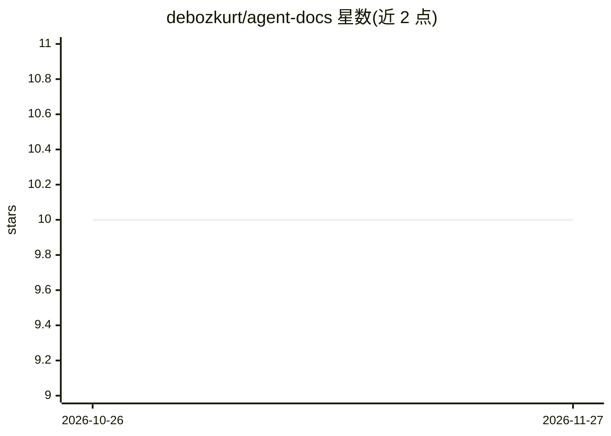

# debozkurt/agent-docs

⭐ 10 · HTML · MIT · 推送 2026-10-25 · [GitHub](https://github.com/debozkurt/agent-docs) · 个人维护

**面向开发者的 LLM Agent 设计参考指南（31 章）**

一本从零构建的线性指南，讲解 LLM agent 系统的设计与架构：从「什么是 agent」起步，覆盖工具设计、MCP、上下文工程、长期记忆、RAG、多智能体编排、评估与安全等 31 章。概念层面框架无关，配套示例基于 LangGraph 与 OpenAI Python SDK，并提供各概念在 LangGraph/OpenAI Agents SDK/Claude Agent SDK 间的对照表。附研讨课幻灯片、可运行的实验室代码及约 280 行的完整 todo agent 示例。章节与幻灯片采用 CC BY 4.0，演示代码采用 MIT 许可。

## 筛选速览

| 维度 | 判定 | 备注 |
|---|---|---|
| AI 角色 | `ai-knowledge` | 知识聚合/清单类 |
| 许可风险 | `permissive` | MIT |
| 部署形态 | `None` |  |
| 模型依赖 | — | README 未给出锁定关系 |
| 硬件要求 | — | 无带数字的原话,不猜 |
| 安装摩擦 | `low` | 无编译、无系统依赖或容器化 |
| 成熟度 | — | 结构信号不足 |

## 能力要点

- 31 章线性结构，从基础概念到多智能体架构与生产关切
- 框架无关概念 + LangGraph/OpenAI Agents SDK/Claude Agent SDK 对照表
- 附研讨课幻灯片与可运行实验室代码（路由器、human-in-the-loop）
- 约 280 行可 fork 的端到端 todo agent 完整示例

## 适用场景

- 从零学习 agent 系统的设计概念与架构模式
- 为团队设计讨论提供命名的模式/反模式与决策框架
- 在多个 SDK 之间查找同一概念的对应实现方式
- 用实验室代码练习路由与 human-in-the-loop 模式

## 场景标签

`教程课程` · 领域:学习与行业

## 证据(README 行号)

> L5: A linear, build-up-from-zero guide to designing and architecting LLM agent systems. Starts with the absolute basics 
> L71: - Worked example: a todo agent, end to end — one complete agent built across the load-bearing chapters, ~280 lines 
> L75: - AI for Builders: A Crash Course — the crash-course deck from the Prompt Engineers Spring 2026 hackathon.

## 星数曲线

2026-10-26 10 → 2026-11-27 10（+0）

---
*卡片 v1 · prompt 1.4 · 生成 2026-11-19 · 置信度 high · 依据 README sha `119997d615b7` · [字段定义](../../DATASET.md)*
