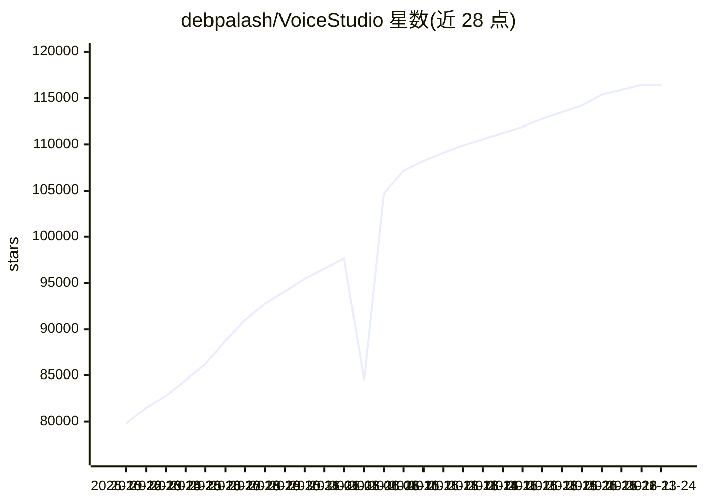

# debpalash/VoiceStudio

⭐ 117,158 · Python · AGPL-3.0 · 推送 2026-11-23 · [GitHub](https://github.com/debpalash/VoiceStudio) · [官网](https://voicestudio.sh) · 组织维护

**本地运行的语音工作室：克隆、配音、转写、有声书**

全本地桌面/移动语音应用，功能覆盖语音克隆、语音设计、视频翻译配音、浮动听写与转写、有声书与批量队列任务。默认引擎为 k2-fsa/OmniVoice，用户可在 Model Manager 中选择数十个其他引擎并按需下载模型。提供 Local API、MCP、CLI、watch folders 与 recipes 用于自动化。AGPL-3.0 应用本身免费且无需账号；Pro 为可选商业许可，Cloud 为尚未上线的托管 API；模型权重许可各异（默认 OmniVoice 权重为 CC-BY-NC 非商用）。

## 筛选速览

| 维度 | 判定 | 备注 |
|---|---|---|
| AI 角色 | `ai-native` | 本体是模型或模型工具 |
| 许可风险 | `dual` | AGPL-3.0 |
| 部署形态 | `desktop` | 安装包/桌面程序 |
| 模型依赖 | — | README 未给出锁定关系 |
| 硬件要求 | — | 无带数字的原话,不猜 |
| 安装摩擦 | `low` | 无编译、无系统依赖或容器化 |
| 成熟度 | — | 结构信号不足 |

## 动量与使用信号

- 维护:`active` — 距上次 push 0.7 天,年发版 42,89 位贡献者
- 涨星:近 1 天 **+3,065**(自 20261016 起算)
- 安装:npm 包 `skills` 月下载 23,786,800
- 平台:WINDOWS / MACOS / LINUX · 协议:MCP

## 能力要点

- 语音克隆、语音设计、视频配音、听写、转写、有声书六大功能，支持 646 种语言
- 默认 k2-fsa/OmniVoice 引擎，Model Manager 支持数十种本地引擎按需下载
- 覆盖 Windows/macOS/Linux/Android/iOS/Docker 多平台安装
- Local API、MCP、CLI 与 watch folders 自动化集成

## 适用场景

- 在笔记本上离线克隆声音并生成语音
- 将视频翻译配音并保持原时间轴
- 批量制作有声书与长文朗读
- 通过本地 API 或 MCP 集成到自动化流程

## 场景标签

`语音合成` `语音识别` · 领域:内容生成

## 证据(README 行号)

> L5:  AI voice studio. On your device.
> L46:  Voice cloning
> L86:  Closed-source build, account required, 7-day full refund. The AGPL-3.0 app stays free, including commercial use un

## 星数曲线

2026-10-22 79,799 → 2026-11-24 116,450（+36,651）

---
*卡片 v1 · prompt 1.4 · 生成 2026-11-22 · 置信度 mid · 依据 README sha `ab9daa00e342` · [字段定义](../../DATASET.md)*
