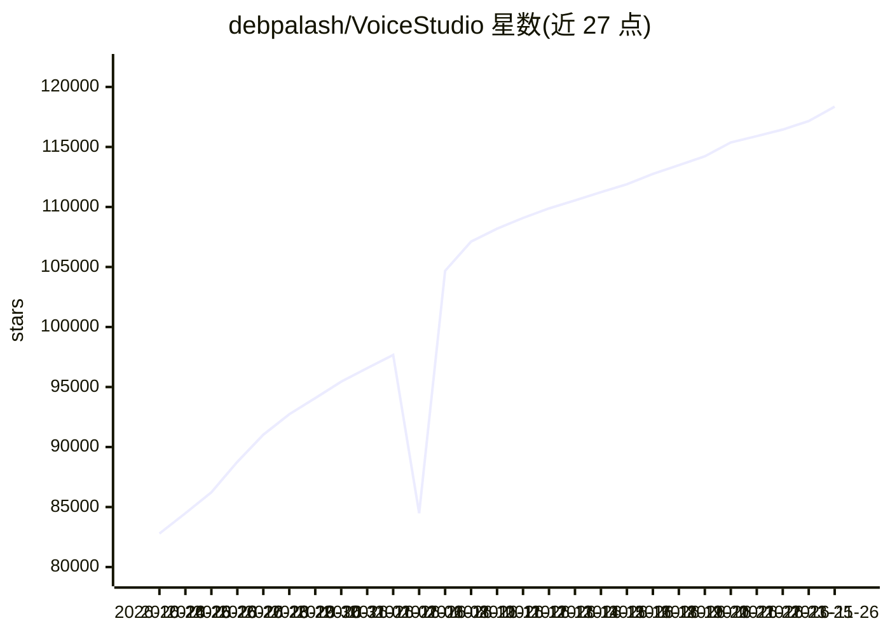

# debpalash/VoiceStudio

⭐ 118,353 · Python · AGPL-3.0 · 推送 2026-11-25 · [GitHub](https://github.com/debpalash/VoiceStudio) · [官网](https://voicestudio.sh) · 组织维护

**全本地 AI 语音工作室：克隆、配音、转写、有声书**

在本地设备运行的语音工作台，功能覆盖声音克隆、文本描述生成声音、视频翻译配音、悬浮听写与本地转写、故事/有声书批量叙述，支持 646 种语言。通过 Model Manager 选择并按需下载本地语音引擎，默认引擎为 k2-fsa/OmniVoice；提供本地 API、MCP、recipes 与 watch folders 做自动化。桌面端覆盖 macOS/Windows/Linux 多种安装方式，另有 Android/iOS 预览版、Docker 镜像与托管 Cloud API（未上线）。应用以 AGPL-3.0 发布，Pro 为可选商业许可，默认模型权重为非商业许可（CC-BY-NC）。

## 筛选速览

| 维度 | 判定 | 备注 |
|---|---|---|
| AI 角色 | `ai-native` | 本体是模型或模型工具 |
| 许可风险 | `dual` | AGPL-3.0 |
| 部署形态 | `desktop` | 安装包/桌面程序 |
| 模型依赖 | — | README 未给出锁定关系 |
| 硬件要求 | — | 无带数字的原话,不猜 |
| 安装摩擦 | `low` | 无编译、无系统依赖或容器化 |
| 成熟度 | — | 结构信号不足 |

## 动量与使用信号

- 维护:`active` — 距上次 push 0.7 天,年发版 42,89 位贡献者
- 涨星:近 1 天 **+3,065**(自 20261016 起算)
- 安装:npm 包 `skills` 月下载 23,786,800
- 平台:WINDOWS / MACOS / LINUX · 协议:MCP

## 能力要点

- 声音克隆、声音设计、视频配音、听写/转写、有声书批量生成
- 646 种语言，模型按需下载，默认引擎 k2-fsa/OmniVoice
- 本地 API、MCP、recipes、watch folders 用于连接与自动化
- 桌面/移动/Docker 多端分发，CPU 可用，支持 CUDA/ROCm/Metal/Vulkan 加速

## 适用场景

- 把参考录音克隆成指定声音来朗读文本
- 给视频翻译配音并按原始时间轴对齐
- 批量生成故事和有声书
- 本地离线转写音频或悬浮听写

## 场景标签

`语音合成` `语音识别` · 领域:内容生成

## 证据(README 行号)

> L5:  AI voice studio. On your device.
> L6:  Clone, design, dub, dictate, transcribe and narrate in 646 languages.
> L71: Start with **VoiceStudio** (default, powered by k2-fsa/OmniVoice), or pick from dozens of other engines in the Mode

## 星数曲线

2026-10-24 82,788 → 2026-11-26 118,353（+35,565）

---
*卡片 v1 · prompt 1.4 · 生成 2026-11-26 · 置信度 high · 依据 README sha `f508e7afd299` · [字段定义](../../DATASET.md)*
