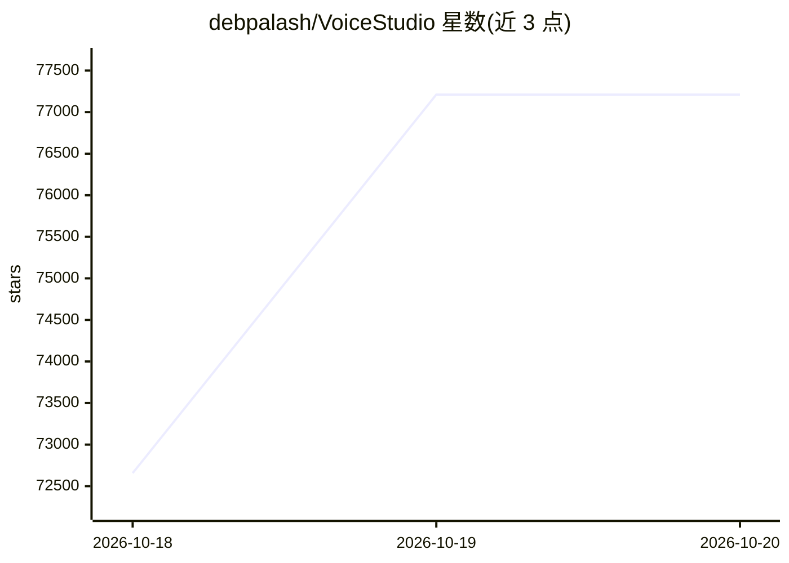

# debpalash/VoiceStudio

⭐ 77,211 · Python · AGPL-3.0 · 推送 2026-10-19 · [GitHub](https://github.com/debpalash/VoiceStudio) · [官网](https://voicestudio.sh) · 个人维护 · 中文 README

**本地优先的开源语音工作站：克隆、配音、转写、有声书**

Electron 桌面应用，聚合语音克隆、语音设计、视频配音、听写、转写与有声书创作等功能，宣称支持 646 种语言。默认引擎为 k2-fpa/OmniVoice（原文 k2-fsa），可切换其他引擎并管理本地语音模型。本地工作流在用户硬件上运行，远程服务为可选；提供本地 API 与 MCP 供 agent 接入。分发方式含一键安装脚本（macOS/Linux/Windows）与 Releases 安装包（.dmg/.exe/.AppImage/.deb），也可从源码运行（Node.js 22+/Bun/Rust）。AGPL-3.0 许可。

## 筛选速览

| 维度 | 判定 | 备注 |
|---|---|---|
| AI 角色 | `ai-native` | 本体是模型或模型工具 |
| 许可风险 | `dual` | AGPL-3.0 |
| 部署形态 | `desktop` | 安装包/桌面程序 |
| 模型依赖 | — | README 未给出锁定关系 |
| 硬件要求 | — | 无带数字的原话,不猜 |
| 安装摩擦 | `medium` | 含编译或系统依赖之一 |
| 成熟度 | `idea` | |

## 动量与使用信号

- 维护:`active` — 距上次 push 0.7 天,年发版 42,89 位贡献者
- 涨星:近 1 天 **+3,065**(自 20261016 起算)
- 安装:npm 包 `skills` 月下载 23,786,800
- 平台:WINDOWS / MACOS / LINUX · 协议:MCP

## 能力要点

- 语音克隆、语音设计、视频配音、转写、听写与有声书创作集成于一个桌面应用
- 本地优先：工作流在本机硬件运行，远程服务可选
- 提供本地 API 与 MCP 接入 agent，可复用配方与监视文件夹
- 默认引擎 k2-fsa/OmniVoice，支持安装管理多个本地语音模型

## 适用场景

- 用参考录音克隆声音并生成配音或旁白
- 为视频生成带时间轴的多语言配音
- 在无 GPU 或 Apple Silicon 设备上本地完成转写与听写

## 场景标签

`语音合成` `语音识别` · 领域:内容生成

## 证据(README 行号)

> L6:  Open-source voice cloning, voice design, video dubbing, dictation, transcription & audiobook creation in 646 langua
> L27: |Clone a voice or design your own|Dub videos with timed speech|Local API & MCP for agents|
> L30: Start with **VoiceStudio** (default, powered by k2-fsa/OmniVoice), or choose another engine. Features & engine cata

## 星数曲线

2026-10-18 72,657 → 2026-10-20 77,211（+4,554）

---
*卡片 v1 · prompt 1.4 · 生成 2026-10-20 · 置信度 mid · 依据 README sha `49da35d42ba1` · [字段定义](../../DATASET.md)*
