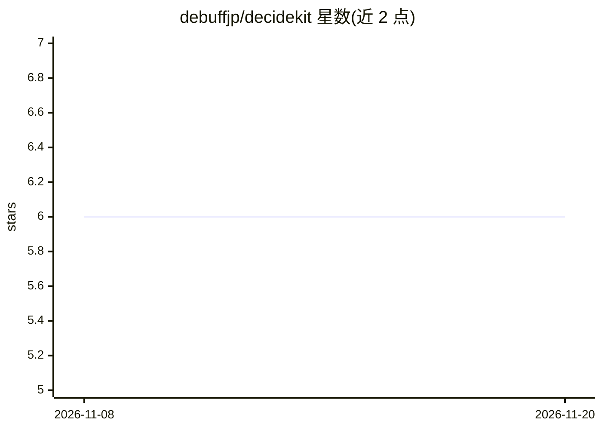

# debuffjp/decidekit

⭐ 6 · TypeScript · MIT · 推送 2026-11-02 · [GitHub](https://github.com/debuffjp/decidekit) · [官网](https://debuff.jp/decide/) · 组织维护

**浏览器内运行的文本分类决策模型库，设备端本地推断与学习**

面向浏览器与 Node 的文本决策模型库：给定标签列表，为文本选出一个标签并给出经过校准的置信度。支持零样本、在页面内或命令行训练小型头（156 KB/77 标签），低置信度样本可回退到外部 LLM 并将其回答作为训练数据。模型文件首次使用时从 Hugging Face 下载并缓存，训练与推断均在用户设备上完成，README 声明无需服务器与 API key。当前版本 0.1，默认模型针对英文短文本。

## 筛选速览

| 维度 | 判定 | 备注 |
|---|---|---|
| AI 角色 | `ai-native` | 本体是模型或模型工具 |
| 许可风险 | `permissive` | MIT |
| 部署形态 | `library` | 以包/库形式分发 |
| 模型依赖 | — | README 未给出锁定关系 |
| 硬件要求 | — | 无带数字的原话,不猜 |
| 安装摩擦 | `low` | 无编译、无系统依赖或容器化 |
| 成熟度 | `idea` | |

## 能力要点

- 带置信度校准的标签分类，支持 zero-shot 与少样本训练
- 低置信度回退 LLM，并将其回答作为训练样本学习
- Web Worker 运行推断与训练，避免阻塞页面主线程
- 提供 React hooks、TypeSafe SDK 兼容层与 CLI 训练命令

## 适用场景

- 客服消息按意图路由分类
- 在浏览器内为数据集打标签
- 文本不能离开设备场景下的意图识别
- 作为调用 LLM 前的低成本预筛步骤

## 场景标签

`微调` `推理引擎` · 领域:训练与推理

## 证据(README 行号)

> L7: A decision model for the browser and Node: it picks one of your labels for a piece of text, with confidence you can 
> L139: decidekit runs the Decide models, each a sentence encoder plus a calibrated head:

## 星数曲线

2026-11-08 6 → 2026-11-20 6（+0）

---
*卡片 v1 · prompt 1.4 · 生成 2026-11-20 · 置信度 high · 依据 README sha `d04f0f6b65f7` · [字段定义](../../DATASET.md)*
