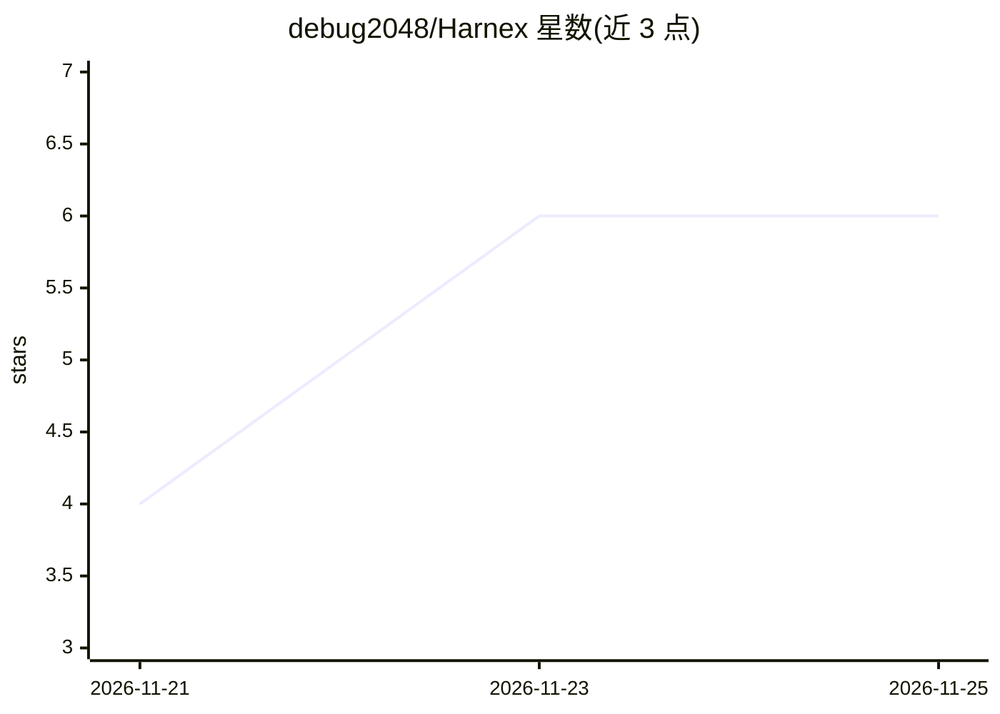

# debug2048/Harnex

⭐ 6 · Java · Apache-2.0 · 推送 2026-11-19 · [GitHub](https://github.com/debug2048/Harnex) · 组织维护 · 中文 README

**面向开发者的多端 AI Agent 工作区：对话、生图与项目任务**

基于 Java 的开源 AI Agent 运行时，将 AI 对话与项目工作合并到一个工作区：用户可提问、生成或编辑图像，或给项目 Agent 下达任务，Agent 能探索代码、编辑文件并运行项目任务，过程支持计划跟踪、操作审批与快照恢复。模型通过协议、URL 与 API key 自行配置接入，工具经 skills 与 MCP 扩展。提供桌面（.exe/.dmg/.AppImage）、Web（Docker）、CLI/TUI 与 VS Code 四类客户端，Linux 运行需系统 GUI 库，离线包不含模型服务。

## 筛选速览

| 维度 | 判定 | 备注 |
|---|---|---|
| AI 角色 | `ai-ecosystem` | LLM/agent 周边工具 |
| 许可风险 | `permissive` | Apache-2.0 |
| 部署形态 | `desktop` | 安装包/桌面程序 |
| 模型依赖 | — | README 未给出锁定关系 |
| 硬件要求 | — | 无带数字的原话,不猜 |
| 安装摩擦 | `low` | 无编译、无系统依赖或容器化 |
| 成熟度 | — | 结构信号不足 |

## 能力要点

- Agent 任务支持计划跟踪、审批与停止，可回滚快照
- 多模型接入：Settings 中配置协议、URL、API key 与模型 ID
- 支持 skills 与 MCP 工具扩展
- Web、桌面、CLI/TUI、VS Code 四类客户端入口

## 适用场景

- 让 Agent 读懂项目结构并代为修改代码
- 在浏览器或终端中与配置好的模型对话
- 通过 SSH 在远程工作区调度 Agent 任务

## 场景标签

`编码 Agent` `聊天机器人` `图像生成` · 领域:编码与开发

## 证据(README 行号)

> L34: |**Choose your models and tools**|Connect model services, add skills and MCP tools, and select what each task can u
> L54: 2. In **Settings → Models**, configure the protocol, provider URL, API key when required, and exact model ID, then 
> L18: Harnex brings AI conversations and project work into one workspace. Ask questions, create images, or give an Agent 

## 星数曲线

2026-11-21 4 → 2026-11-25 6（+2）

---
*卡片 v1 · prompt 1.4 · 生成 2026-11-21 · 置信度 high · 依据 README sha `9d736be2b71a` · [字段定义](../../DATASET.md)*
