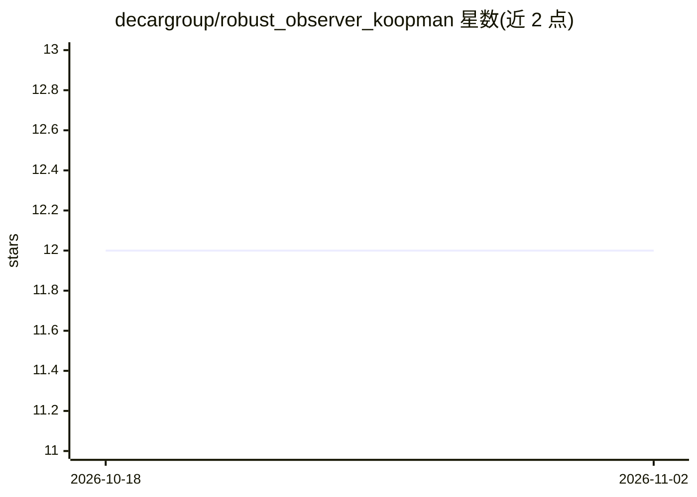

# decargroup/robust_observer_koopman

⭐ 12 · Python · MIT · 推送 2026-08-22 · [GitHub](https://github.com/decargroup/robust_observer_koopman) · [官网](https://arxiv.org/abs/2410.01057) · 组织维护

**Koopman 算子鲁棒观测器合成论文的配套代码**

论文《Uncertainty Modelling and Robust Observer Synthesis using the Koopman Operator》的配套代码库，包含从原始数据复现论文全部图表所需代码。回归方法基于作者的 pykoop 库实现，用 doit 自动化数据预处理、实验执行与图表生成。需先下载电机驱动制造偏差数据集放入 dataset/ 目录，运行 doit 即可在 build/ 输出结果。所用的 LMI 求解器 MOSEK 需要许可证（可申请个人学术许可）。兼容 Linux/macOS/Windows，开发环境为 Python 3.12.6。

## 筛选速览

| 维度 | 判定 | 备注 |
|---|---|---|
| AI 角色 | `ai-native` | 本体是模型或模型工具 |
| 许可风险 | `permissive` | MIT |
| 部署形态 | `library` | 以包/库形式分发 |
| 模型依赖 | — | README 未给出锁定关系 |
| 硬件要求 | — | 无带数字的原话,不猜 |
| 安装摩擦 | `low` | 无编译、无系统依赖或容器化 |
| 成熟度 | — | 结构信号不足 |

## 能力要点

- 基于 pykoop 实现 Koopman 回归方法
- doit 自动化预处理、实验与图表生成，可按任务单独执行
- 包含观测器合成、正弦提升函数、传递函数残差界等模块

## 适用场景

- 复现论文图表与实验结果
- 在电机驱动数据集上运行 Koopman 不确定性与鲁棒观测器实验
- 参考观测器合成与残差界定代码开展相关研究

## 场景标签

 · 领域:控制/动力系统

## 证据(README 行号)

> L3: This repository contains the companion code for [Uncertainty Modelling and
> L8: The regression methods detailed in the paper are implemented using
> L9: `pykoop`, the authors' Koopman operator

## 星数曲线

2026-10-18 12 → 2026-11-02 12（+0）

---
*卡片 v1 · prompt 1.4 · 生成 2026-11-01 · 置信度 high · 依据 README sha `e345bf7270d5` · [字段定义](../../DATASET.md)*
