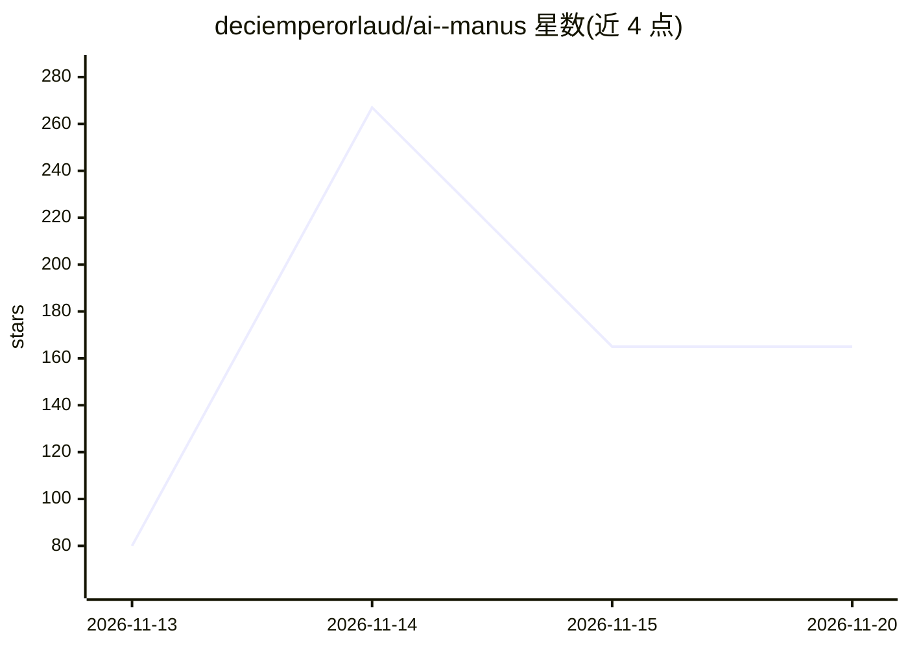

# deciemperorlaud/ai--manus

⭐ 165 · Apache-2.0 · 推送 2026-11-15 · [GitHub](https://github.com/deciemperorlaud/ai--manus) · 个人维护

**面向个人日常任务的自主 AI Agent：运行代码并控制浏览器**

Manus 是一个自主运行的 AI agent，用户描述需求后由其代为编写并执行脚本、打开网页、与页面元素交互、完成多步任务；定位为家庭、学习与轻量办公场景的个人助手，而非企业级平台。README 说明其可在脚本与浏览器操作之间衔接工作流，并在会话间重复应用已识别的任务模式。安装仅给出下载入口（附 PROMO2026 代码）与配置步骤，未提供命令行安装方式；并列出最低双核 CPU、4 GB 内存的兼容性表。

## 筛选速览

| 维度 | 判定 | 备注 |
|---|---|---|
| AI 角色 | `ai-native` | 本体是模型或模型工具 |
| 许可风险 | `permissive` | Apache-2.0 |
| 部署形态 | `None` |  |
| 模型依赖 | — | README 未给出锁定关系 |
| 硬件要求 | — | 无带数字的原话,不猜 |
| 安装摩擦 | `low` | 无编译、无系统依赖或容器化 |
| 成熟度 | — | 结构信号不足 |

## 能力要点

- 自主编写并执行代码完成任务
- 浏览器控制：导航、填表、抓取信息
- 脚本与浏览器操作衔接为单一工作流
- 面向家庭/学习/轻量办公的小规模场景

## 适用场景

- 让学生整理研究笔记、跑小型计算脚本
- 让 agent 汇总多个网页信息准备简报
- 把重复性的日常小任务交给后台助手处理

## 场景标签

`AI 助手` `浏览器自动化` · 领域:效率与自动化

## 证据(README 行号)

> L18: Manus is an autonomous AI agent designed to run code and control a browser on your behalf. Instead of acting like a

## 星数曲线

2026-11-13 80 → 2026-11-20 165（+85）

---
*卡片 v1 · prompt 1.4 · 生成 2026-11-17 · 置信度 low · 依据 README sha `0f78ee3a5dd2` · [字段定义](../../DATASET.md)*
