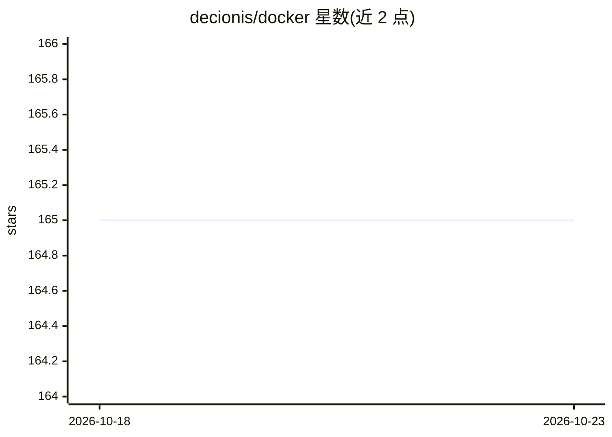

# decionis/docker

⭐ 165 · Go · Apache-2.0 · 推送 2026-08-25 · [GitHub](https://github.com/decionis/docker) · [官网](https://www.decionis.com) · 组织维护

**在 Docker 中治理 AI agent 敏感操作的执行授权层**

面向在容器、Dev Container、CI/CD 与 MCP 工具链中运行的 AI agent 的执行授权控制面：agent 提出敏感动作（如部署、改生产数据、发布包、调用特权 MCP 工具）时，先对照确定性版本化策略评估，输出 PROCEED/HOLD/BLOCK 决定；HOLD 可触发 Presence 人工审批（passkey/受信设备），每次决策可生成 Ed25519 签名的 Decision Dossier 作为可验证证据。本仓库提供 MCP Server、Docker Desktop 扩展与 Dev Container 集成，组件将随 Docker 开发体验分阶段发布。Decionis 本身不执行下游动作。

## 筛选速览

| 维度 | 判定 | 备注 |
|---|---|---|
| AI 角色 | `ai-ecosystem` | LLM/agent 周边工具 |
| 许可风险 | `permissive` | Apache-2.0 |
| 部署形态 | `self-host` | docker 或自建部署 |
| 模型依赖 | — | README 未给出锁定关系 |
| 硬件要求 | — | 无带数字的原话,不猜 |
| 安装摩擦 | `low` | 无编译、无系统依赖或容器化 |
| 成熟度 | `idea` | |

## 能力要点

- 动作执行前的确定性策略评估（PROCEED/HOLD/BLOCK）
- Presence 人工审批：passkey 与受信设备的动作绑定验证
- Ed25519 签名、可独立验证的 Decision Dossier
- 以容器化 MCP Server 与 Docker Desktop 扩展形式提供

## 适用场景

- 生产部署、基础设施变更等敏感 agent 操作前做授权决策
- 团队为 AI 辅助开发建立统一的执行权限边界
- 审计 agent 被授权执行的原因并留存密码学证据

## 场景标签

`网络安全` · 领域:学习与行业

## 证据(README 行号)

> L14: Decionis adds an explicit authority boundary between an AI agent's intent and consequential execution.
> L166: Decionis is an **execution-authorization control plane**.
> L68: Run **Decionis Execution Authority** as a containerized MCP service for compatible agent environments and MCP clien

## 星数曲线

2026-10-18 165 → 2026-10-23 165（+0）

---
*卡片 v1 · prompt 1.4 · 生成 2026-10-22 · 置信度 mid · 依据 README sha `292fe494e35a` · [字段定义](../../DATASET.md)*
