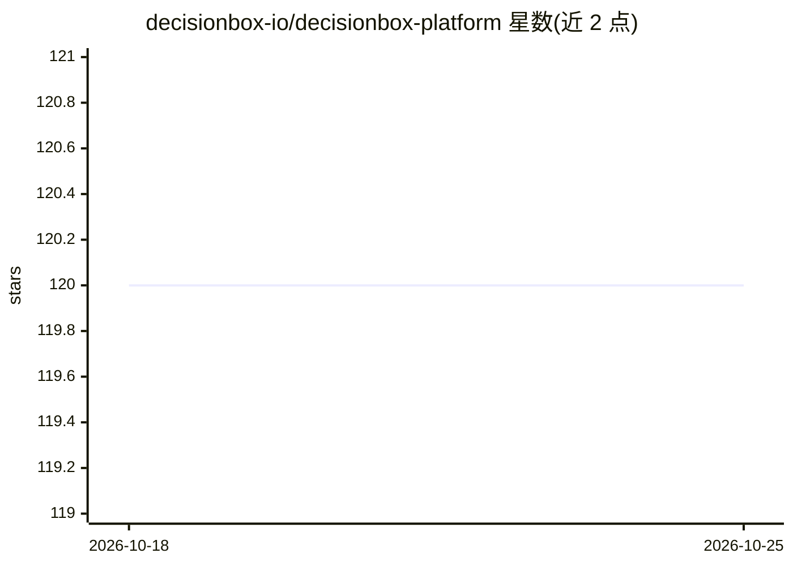

# decisionbox-io/decisionbox-platform

⭐ 120 · Go · AGPL-3.0 · 推送 2026-10-24 · [GitHub](https://github.com/decisionbox-io/decisionbox-platform) · [官网](https://decisionbox.io) · 组织维护

**面向数据仓库的自主 AI 数据洞察发现平台**

连接 BigQuery、Redshift、Snowflake、PostgreSQL、Databricks、SQL Server 等数据仓库，由 AI agent 自主决定调查方向，编写并执行 SQL（每次发现运行 50–100+ 条查询），产出经独立复验的洞察与排序建议，全程记录 SQL 与推理步骤。支持 Qdrant 向量语义搜索与 RAG 式 Ask Insights 问答；领域包机制按行业适配分析（内置电商、社交、游戏）。LLM 支持 Claude、OpenAI、Ollama 本地、Vertex AI、Bedrock、Azure AI Foundry、LiteLLM，可自托管（AGPL v3），提供 Docker Compose、Helm、Terraform 部署。需 MongoDB 与 Qdrant 等组件。

## 筛选速览

| 维度 | 判定 | 备注 |
|---|---|---|
| AI 角色 | `ai-native` | 本体是模型或模型工具 |
| 许可风险 | `viral` | AGPL-3.0 |
| 部署形态 | `self-host` | docker 或自建部署 |
| 模型依赖 | local-ok | 支持本地模型 |
| 硬件要求 | — | 无带数字的原话,不猜 |
| 安装摩擦 | `low` | 无编译、无系统依赖或容器化 |
| 成熟度 | — | 结构信号不足 |

## 能力要点

- 自主 agent 编写并执行 SQL，每次运行 50–100+ 条查询，无需提问
- 每条洞察经独立复核查询验证后才输出，SQL 与推理全程留痕
- 内置电商/社交/游戏领域包，可在仪表盘创建与导入自定义包
- Qdrant 语义搜索与带引用的 RAG 问答（Ask Insights）

## 适用场景

- 让 AI 自动在数据仓库中发现业务洞察和建议
- 用本地或自有 LLM 在自有基础设施上做数据分析
- 为特定行业定制领域包进行专项数据分析

## 场景标签

`数据分析` `RAG` · 领域:效率与自动化

## 证据(README 行号)

> L13: **Autonomous AI data discovery on your data warehouse.** DecisionBox connects to your warehouse, runs an agent that
> L21: - **Autonomous, not a copilot.** The agent picks what to investigate. 50–100+ SQL queries per discovery run, unatte
> L45: - **Autonomous agent loop** — AI writes and executes SQL, iterates on results, and produces insights + ranked recom

## 星数曲线

2026-10-18 120 → 2026-10-25 120（+0）

---
*卡片 v1 · prompt 1.4 · 生成 2026-10-23 · 置信度 high · 依据 README sha `cbba69894202` · [字段定义](../../DATASET.md)*
