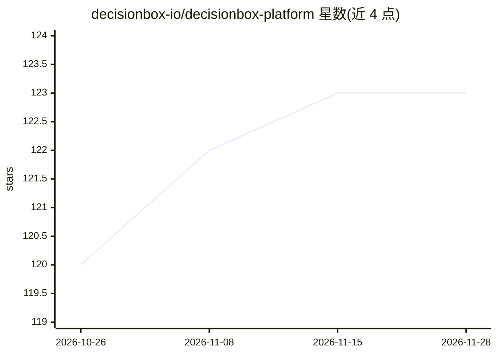

# decisionbox-io/decisionbox-platform

⭐ 123 · Go · AGPL-3.0 · 推送 2026-11-27 · [GitHub](https://github.com/decisionbox-io/decisionbox-platform) · [官网](https://decisionbox.io) · 组织维护

**连接数据仓库的自主 AI 数据发现分析平台**

自托管的开源数据发现平台：接入数据仓库后，自主 agent 决定调查方向、编写并执行 SQL（每次运行 50–100+ 条查询），每条结论经独立复核查询验证后交付带置信度排序的洞察与建议，全过程查询与推理步骤留痕可审计。支持 RAG 问答、向量语义搜索（Qdrant）、领域包定制（电商/社交/游戏内置）与插件扩展。通过 Docker Compose、Helm 或 Terraform 部署，LLM 与数据仓库均可按项目配置。

## 筛选速览

| 维度 | 判定 | 备注 |
|---|---|---|
| AI 角色 | `ai-native` | 本体是模型或模型工具 |
| 许可风险 | `viral` | AGPL-3.0 |
| 部署形态 | `self-host` | docker 或自建部署 |
| 模型依赖 | local-ok | 支持本地模型 |
| 硬件要求 | — | 无带数字的原话,不猜 |
| 安装摩擦 | `low` | 无编译、无系统依赖或容器化 |
| 成熟度 | — | 结构信号不足 |

## 能力要点

- 自主 agent 循环：无需提问即编写并执行 SQL 产出洞察与建议
- 每条结论经独立复核查询验证，SQL 与推理步骤全程留痕
- RAG 问答与向量语义搜索（Qdrant + HNSW）带引用
- 领域包机制：电商/社交/游戏内置，可从仪表盘创建/导入

## 适用场景

- 电商运营自动发现转化漏斗与购物车弃单问题
- 对仓库数据做定期无人值守的自动分析并收到行动建议
- SaaS 团队排查留存与激活模式
- 用自然语言提问并引用洞察来源

## 场景标签

`数据分析` `RAG` `语义搜索` · 领域:效率与自动化

## 证据(README 行号)

> L13: **Autonomous AI data discovery on your data warehouse.** DecisionBox connects to your warehouse, runs an agent that
> L36: 1. **Connect** your data warehouse (BigQuery, Redshift, Snowflake, PostgreSQL, Databricks, Microsoft SQL Server)

## 星数曲线

2026-10-26 120 → 2026-11-28 123（+3）

---
*卡片 v1 · prompt 1.4 · 生成 2026-11-28 · 置信度 high · 依据 README sha `45a7bdfa987e` · [字段定义](../../DATASET.md)*
