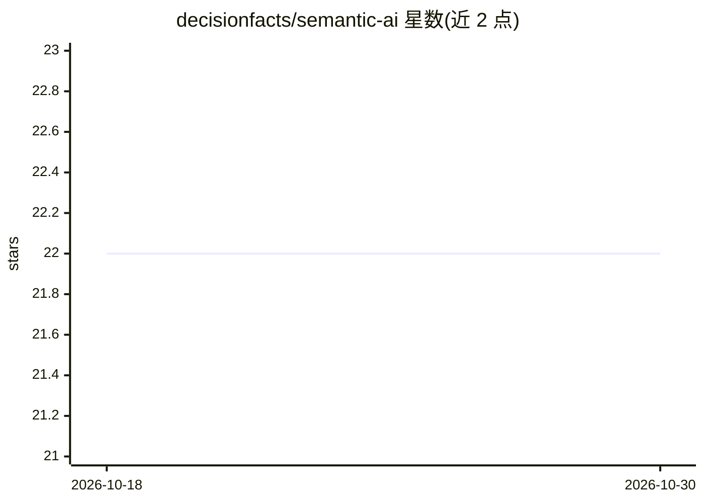

# decisionfacts/semantic-ai

⭐ 22 · Python · Apache-2.0 · 推送 2025-11-21 · [GitHub](https://github.com/decisionfacts/semantic-ai) · [官网](https://docs-semantic-ai.decisionfacts.ai/) · 组织维护

**面向开发者的 Python RAG 框架：下载、抽取、索引、检索生成一体化**

开源 Python 框架，实现检索增强生成（RAG）流程：从数据源（如 SharePoint、SQLite、MySQL）下载文件，抽取内容（含 OCR/文档解析），索引到向量数据库，再通过 LLM 检索并生成对话式回答。支持非结构化文件与结构化数据库两类数据，凭证通过 .env 配置单一 connector/indexer/LLM。提供 semantic_ai serve 命令以 FastAPI 服务方式运行并自带 Swagger UI 文档。需 Python 3.10+。

## 筛选速览

| 维度 | 判定 | 备注 |
|---|---|---|
| AI 角色 | `ai-ecosystem` | LLM/agent 周边工具 |
| 许可风险 | `permissive` | Apache-2.0 |
| 部署形态 | `library` | 以包/库形式分发 |
| 模型依赖 | — | README 未给出锁定关系 |
| 硬件要求 | — | 无带数字的原话,不猜 |
| 安装摩擦 | `low` | 无编译、无系统依赖或容器化 |
| 成熟度 | — | 结构信号不足 |

## 能力要点

- download→extract→index→search 的异步 Python API 流程
- 支持非结构化文件与结构化数据库（SQLite/MySQL）检索生成
- semantic_ai serve 启动 FastAPI 服务，自带交互式 API 文档

## 适用场景

- 我对企业文件源（如 SharePoint）建 RAG 问答
- 我直接对数据库表内容做检索式问答
- 我把 RAG 流程部署为 API 服务供其他系统调用

## 场景标签

`RAG` `文档解析` · 领域:知识与检索

## 证据(README 行号)

> L6: An open-source framework for Retrieval-Augmented System (RAG) uses semantic search to retrieve the expected results 
> L51: ### 2. To download the files from a given source, extract the content from the downloaded files and index the extra
> L58: ### 3. To generate the answer from indexed vector db using retrieval LLM model.

## 星数曲线

2026-10-18 22 → 2026-10-30 22（+0）

---
*卡片 v1 · prompt 1.4 · 生成 2026-10-27 · 置信度 high · 依据 README sha `267e27a3fc85` · [字段定义](../../DATASET.md)*
