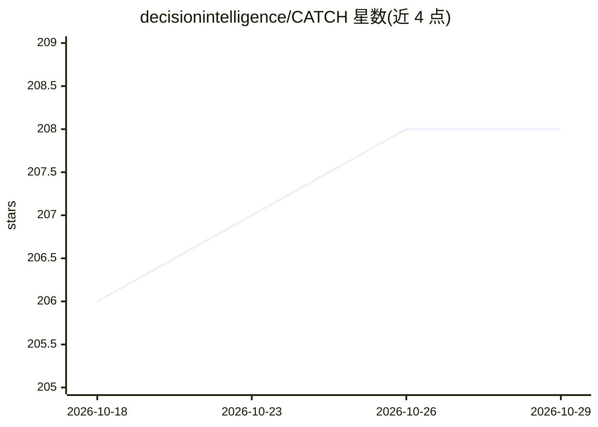

# decisionintelligence/CATCH

⭐ 208 · Python · 推送 2025-12-30 · [GitHub](https://github.com/decisionintelligence/CATCH) · [官网](https://arxiv.org/pdf/2410.12261) · 组织维护

**多变量时间序列异常检测框架（ICLR 2025 论文官方实现）**

CATCH 是 ICLR 2025 论文的官方 PyTorch 实现，面向多变量时间序列异常检测。基于频域补丁化（frequency patching）与通道融合模块（含补丁级掩码生成器与掩码注意力机制），通过双层多目标优化迭代发现补丁级通道相关性，聚类相似通道并隔离无关通道影响。提供预处理数据集下载、实验脚本与基线模型评测框架（TAB，已被 PVLDB 2025 接收）。在 Python 3.8 环境下测试，通过 pip 安装依赖后以 shell 脚本运行训练与评测。

## 筛选速览

| 维度 | 判定 | 备注 |
|---|---|---|
| AI 角色 | `ai-native` | 本体是模型或模型工具 |
| 许可风险 | `none` | — |
| 部署形态 | `library` | 以包/库形式分发 |
| 模型依赖 | — | README 未给出锁定关系 |
| 硬件要求 | — | 无带数字的原话,不猜 |
| 安装摩擦 | `low` | 无编译、无系统依赖或容器化 |
| 成熟度 | — | 结构信号不足 |

## 能力要点

- 基于频率补丁化与通道融合模块的异常检测
- 双层多目标优化发现补丁级通道相关性
- 提供预处理数据集与 CATCH 及基线实验脚本
- 关联评测框架 TAB（PVLDB 2025）

## 适用场景

- 在 MSL 等时间序列数据集上复现异常检测实验
- 研究通道相关性与频域方法在异常检测中的应用
- 对比基线模型进行时间序列异常检测评测

## 场景标签

 · 领域:时间序列异常检测

## 证据(README 行号)

> L3: **This code is the official PyTorch implementation of our ICLR'25 paper: CATCH: Channel-Aware Multivariate Time Seri
> L15: **CATCH**, a framework based on frequency patching, flexibly utilizing the channel correlations to reconstruct all 

## 星数曲线

2026-10-18 206 → 2026-10-29 208（+2）

---
*卡片 v1 · prompt 1.4 · 生成 2026-10-22 · 置信度 mid · 依据 README sha `aed244d65fbb` · [字段定义](../../DATASET.md)*
