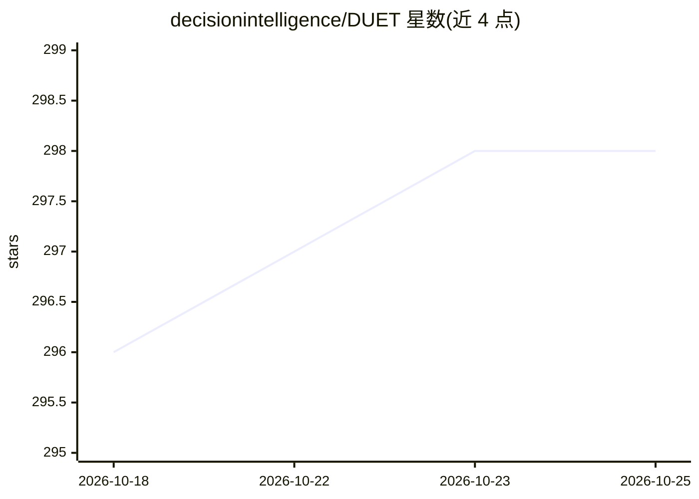

# decisionintelligence/DUET

⭐ 298 · Shell · MIT · 推送 2026-05-12 · [GitHub](https://github.com/decisionintelligence/DUET) · [官网](https://arxiv.org/pdf/2412.10859) · 组织维护 · 中文 README

**KDD'25 论文 DUET 的官方 PyTorch 实现：多变量时序预测模型**

DUET 是 KDD 2025 论文《Dual Clustering Enhanced Multivariate Time Series Forecasting》的官方 PyTorch 实现仓库。模型通过在时间维度与通道维度的双重聚类（TCM 子序列分布聚类、CCM 通道软聚类）增强多变量时序预测，组件含 Distribution Router、Linear Pattern Extractor、Learnable Distance Metric 与 Fusion Module。在 Python 3.8 下测试，通过 requirements.txt 安装依赖，从 Google Drive/Baidu Drive 获取预处理数据集后用 scripts 脚本训练与评估；评估采用 TFB 统一框架，覆盖 25 个数据集，输入长度固定 96 的统一超参结果已发布。面向复现论文实验与时序预测研究的科研用户。

## 筛选速览

| 维度 | 判定 | 备注 |
|---|---|---|
| AI 角色 | `ai-native` | 本体是模型或模型工具 |
| 许可风险 | `permissive` | MIT |
| 部署形态 | `library` | 以包/库形式分发 |
| 模型依赖 | — | README 未给出锁定关系 |
| 硬件要求 | — | 无带数字的原话,不猜 |
| 安装摩擦 | `low` | 无编译、无系统依赖或容器化 |
| 成熟度 | — | 结构信号不足 |

## 能力要点

- 时间/通道双重聚类（TCM+CCM）的多变量时序预测模型
- 提供全部实验脚本，基于 TFB 统一评估框架
- 在 25 个真实数据集（10 个应用领域）上给出实验结果
- 统一超参与固定回看窗口 96 的长期预测结果可复现

## 适用场景

- 复现 KDD'25 论文 DUET 的实验结果
- 作为多变量时序长期预测任务的模型基线
- 在自有数据集上训练时序预测模型

## 场景标签

 · 领域:时间序列预测/机器学习

## 证据(README 行号)

> L5: This code is the official PyTorch implementation of our KDD'25 paper: DUET: Dual Clustering Enhanced Multivariate Ti
> L22: **DUET**, which introduces a <ins>**DU**</ins>al clustering on the temporal and channel dimensions to <ins>**E**</i

## 星数曲线

2026-10-18 296 → 2026-10-25 298（+2）

---
*卡片 v1 · prompt 1.4 · 生成 2026-10-21 · 置信度 mid · 依据 README sha `11bfadd88af4` · [字段定义](../../DATASET.md)*
