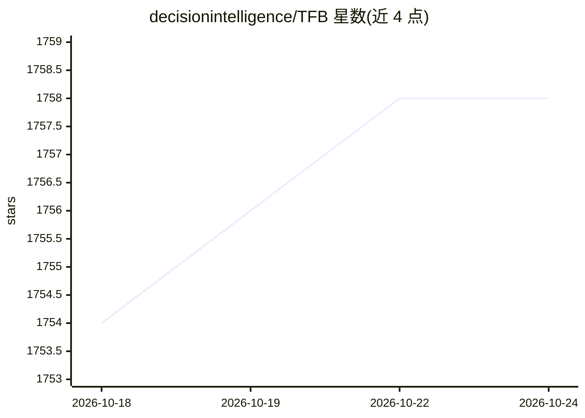

# decisionintelligence/TFB

⭐ 1,758 · Shell · MIT · 推送 2026-10-08 · [GitHub](https://github.com/decisionintelligence/TFB) · [官网](https://www.vldb.org/pvldb/vol17/p2363-hu.pdf) · 组织维护 · 中文 README

**面向研究者的时间序列预测方法端到端评测基准库**

面向时间序列预测研究者的开源评测库（PVLDB 2024 最佳论文提名）：提供干净代码库，在多种评测策略与指标下对预测模型与基线算法进行端到端对比；收录 27 个多变量数据集（含 PEMS03/PEMS07）及 DLinear、PatchTST、FITS、DUET 等基线实现，配套实验脚本与 OpenTS-Bench 排行榜；强调测试阶段不使用 drop-last 以保证公平。支持 pip 依赖安装与 Docker，推荐 Python 3.8；提供自研方法开发与自有数据评测教程（中英文）。

## 筛选速览

| 维度 | 判定 | 备注 |
|---|---|---|
| AI 角色 | `ai-ecosystem` | LLM/agent 周边工具 |
| 许可风险 | `permissive` | MIT |
| 部署形态 | `self-host` | docker 或自建部署 |
| 模型依赖 | — | README 未给出锁定关系 |
| 硬件要求 | — | 无带数字的原话,不猜 |
| 安装摩擦 | `low` | 无编译、无系统依赖或容器化 |
| 成熟度 | — | 结构信号不足 |

## 能力要点

- 27 个多变量数据集与数十个基线算法实现的统一评测
- 多种评测策略与指标下的端到端对比，实验脚本一键复现
- 测试阶段避免 drop-last 操作的公平性设计
- 提供时间序列特征计算代码（趋势/季节性/平稳性/相关性等）

## 适用场景

- 在统一基准下对比自己提出的预测模型与已有基线
- 复现论文实验结果或查阅 OpenTS-Bench 排行榜
- 在自有时间序列数据上评测算法表现

## 场景标签

`模型评测` · 领域:评测与运维

## 证据(README 行号)

> L62: TFB is an open-source library designed for time series forecasting researchers.
> L64: We provide a clean codebase for end-to-end evaluation of time series forecasting models, comparing their performanc

## 星数曲线

2026-10-18 1,754 → 2026-10-24 1,758（+4）

---
*卡片 v1 · prompt 1.4 · 生成 2026-10-21 · 置信度 high · 依据 README sha `457d73a2985b` · [字段定义](../../DATASET.md)*
