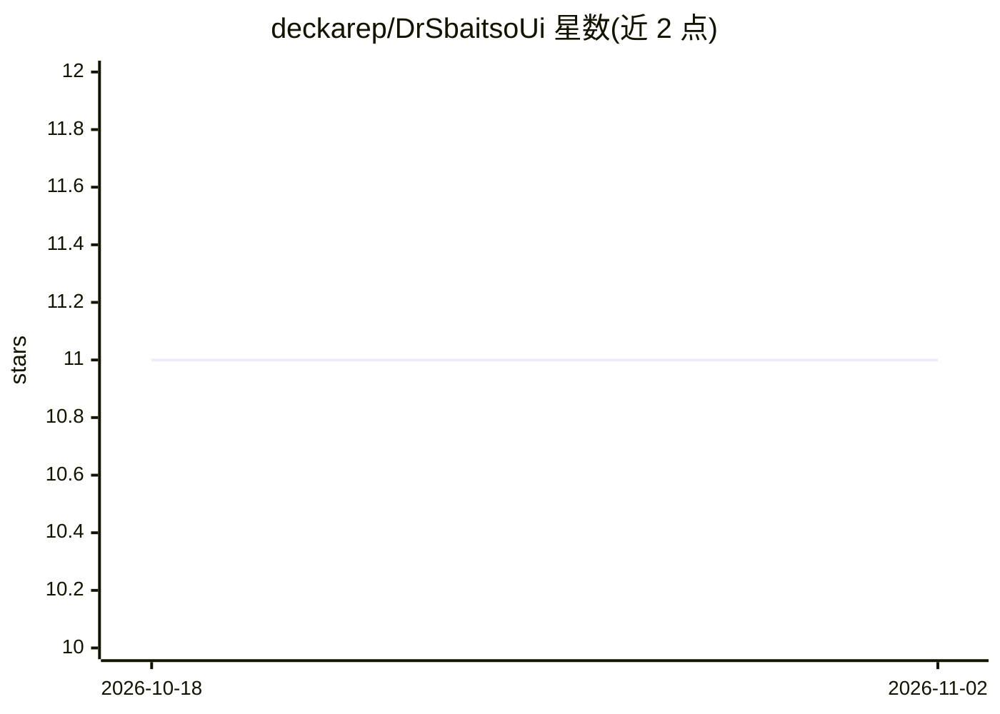

# deckarep/DrSbaitsoUi

⭐ 11 · Zig · MIT · 推送 2026-10-02 · [GitHub](https://github.com/deckarep/DrSbaitsoUi) · [官网](https://drsbaitso.fly.dev) · 个人维护

**用 Zig+Raylib 复刻经典 DOS 聊天机器人 Dr. Sbaitso 的桌面前端**

面向复古计算爱好者的 Dr. Sbaitso 非官方重制：以 Zig 和 Raylib 6.0 实现的原生桌面应用，无需 DOSBox 等模拟器。默认模式加载从原版二进制提取的 JSON 应答库，复现 Turbo C 界面、原始语音、Eliza 式对话脑及 parity 错误等彩蛋；支持可替换的语音合成后端（原生引擎、macOS Speech Synthesis、Web Speech）与可替换脑（含 ChatGPT/Claude/Ollama 等 LLM 脑）。当前仅支持 macOS，且后端语音引擎尚未公开，仓库现状无法直接运行，构建需 Zig 0.16.0。

## 筛选速览

| 维度 | 判定 | 备注 |
|---|---|---|
| AI 角色 | `ai-native` | 本体是模型或模型工具 |
| 许可风险 | `permissive` | MIT |
| 部署形态 | `desktop` | 安装包/桌面程序 |
| 模型依赖 | local-ok | 支持本地模型 |
| 硬件要求 | — | 无带数字的原话,不猜 |
| 安装摩擦 | `low` | 无编译、无系统依赖或容器化 |
| 成熟度 | `idea` | |

## 能力要点

- 复现原版应答库、语音与 Turbo C 环境，原生应用无需 DOSBox
- 可替换脑：Eliza 式应答、用户自制重组文件、ChatGPT/Claude/Ollama 等 LLM
- 可替换语音合成后端并调节音调/音量/音高/语速
- 跨线程通信用线程安全队列，阻塞操作在辅助线程执行

## 适用场景

- 在现代桌面上原汁原味体验 90 年代 Dr. Sbaitso 聊天机器人
- 接入 LLM 脑让复古界面与现代模型对话
- 作为 Raylib GUI 应用中使用原生 OS 线程的示例项目

## 场景标签

`聊天机器人` `语音合成` · 领域:对话与助手

## 证据(README 行号)

> L17: A front-end for Dr. Sbaitso created in `Zig` and `Raylib 6.0`: For modern Desktops as a standalone application.
> L40: 3. *All* of the Dr's original text-to-speech responses
> L45:  * LLM Brains: ChatGPT, Claude, Ollama, etc.

## 星数曲线

2026-10-18 11 → 2026-11-02 11（+0）

---
*卡片 v1 · prompt 1.4 · 生成 2026-11-02 · 置信度 high · 依据 README sha `78d8660bb030` · [字段定义](../../DATASET.md)*
