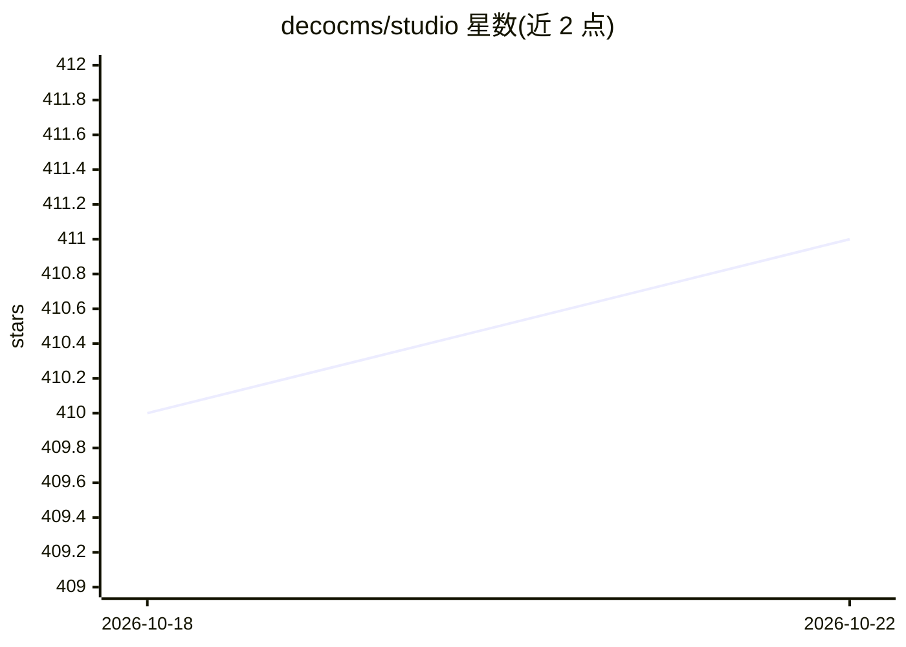

# decocms/studio

⭐ 411 · TypeScript · MIT · 推送 2026-10-21 · [GitHub](https://github.com/decocms/studio) · [官网](https://decocms.com/studio) · 组织维护

**组织内部 AI agent 的开源控制平面：接入工具、模型与成本追踪**

面向组织的自托管 AI 工作区：将上下文、工具与策略打包为可发布的 agent，每个 agent 是一个 MCP endpoint，可被 Cursor、Claude Desktop 或自有代码调用。组织级注册 MCP 服务器，令牌存于加密 vault，按角色/agent 授予工具级访问。模型层可切换：OpenRouter 或直连 Anthropic、OpenAI、Google 等。内置 SSO、RBAC、审计日志、成本归因与 OpenTelemetry 追踪。本地 Docker Compose 运行，云端或 Helm 自托管。

## 筛选速览

| 维度 | 判定 | 备注 |
|---|---|---|
| AI 角色 | `ai-ecosystem` | LLM/agent 周边工具 |
| 许可风险 | `permissive` | MIT |
| 部署形态 | `self-host` | docker 或自建部署 |
| 模型依赖 | locked-api |  |
| 硬件要求 | — | 无带数字的原话,不猜 |
| 安装摩擦 | `low` | 无编译、无系统依赖或容器化 |
| 成熟度 | — | 结构信号不足 |

## 能力要点

- 每个 agent 即一个 MCP endpoint，带成本归因与审计
- Virtual MCPs 将工具集组合暴露为受治理的新 endpoint
- 模型层可切换：OpenRouter 或直连多家 provider
- SSO + RBAC（Better Auth，OAuth 2.1）与多租户隔离

## 适用场景

- 为团队统一管理 agent、私有 MCP 连接与模型接入
- 追踪每次模型/工具调用的 token 与成本并做归因
- 在企业内网自托管受 SSO 与审计约束的 AI 平台

## 场景标签

`Agent 框架` · 领域:Agent 开发

## 证据(README 行号)

> L29: Studio packages the infrastructure behind an internal AI rollout: model routing, MCP authentication, agent configur
> L31: Under the hood it's one control plane for your AI agents — one MCP endpoint for all your agents, tools, and models.

## 星数曲线

2026-10-18 410 → 2026-10-22 411（+1）

---
*卡片 v1 · prompt 1.4 · 生成 2026-10-21 · 置信度 high · 依据 README sha `b28715b1107d` · [字段定义](../../DATASET.md)*
