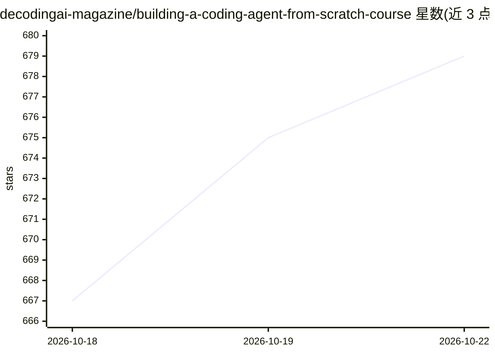

# decodingai-magazine/building-a-coding-agent-from-scratch-course

⭐ 679 · Python · Apache-2.0 · 推送 2026-10-10 · [GitHub](https://github.com/decodingai-magazine/building-a-coding-agent-from-scratch-course) · 组织维护

**面向工程师的开源课程：从零构建编程 Agent 学 harness 工程**

由 Decoding AI Magazine 与 Modal、Opik（Comet）、Kitaru（ZenML）合作制作的开源 harness 工程课程，含 8 篇文章、6 个视频和一份 Apache-2.0 代码库。学习者从约 20 行的 agent 循环出发，逐步构建名为 decode 的编程 Agent：TUI 与远程两种界面、Docker/Modal 沙箱、权限层、记忆与压缩、子代理扇出、Opik 可观测性与 Kitaru 回放评测。技术栈基于 Pydantic AI，LLM 提供方可选 Gemini、OpenRouter 或 Modal 上自托管的 SGLang 开源模型。前置要求为中级 Python，全程云端运行 LLM、无需 GPU，坚持免费额度成本为 $0。

## 筛选速览

| 维度 | 判定 | 备注 |
|---|---|---|
| AI 角色 | `ai-knowledge` | 知识聚合/清单类 |
| 许可风险 | `permissive` | Apache-2.0 |
| 部署形态 | `None` |  |
| 模型依赖 | — | README 未给出锁定关系 |
| 硬件要求 | `cpu-ok` | |
| 安装摩擦 | `medium` | 含编译或系统依赖之一 |
| 成熟度 | — | 结构信号不足 |

## 能力要点

- 8 篇文章 + 6 个视频 + 可运行代码库（Apache-2.0）
- 从 agent 循环到权限层、沙箱、记忆压缩、子代理扇出的完整 harness 构建
- Opik 可观测性/评测与 Kitaru 会话记录回放集成
- LLM 提供方可切换：Gemini / OpenRouter / Modal 自托管 SGLang

## 适用场景

- ML/AI 工程师系统学习编程 Agent 的 harness 工程模式
- 软件工程师转岗进入 agentic 系统开发的实践课程
- 动手运行成品 Agent 并复用其架构于自己的应用

## 场景标签

`教程课程` · 领域:学习与行业

## 证据(README 行号)

> L3:  Learn harness engineering by building Claude Code from scratch, from a bare-bones agent loop to a swarm of cloud ag
> L6:  Open-source course
> L8:  8 articles

## 星数曲线

2026-10-18 667 → 2026-10-22 679（+12）

---
*卡片 v1 · prompt 1.4 · 生成 2026-10-21 · 置信度 high · 依据 README sha `b04aa9a65fd3` · [字段定义](../../DATASET.md)*
