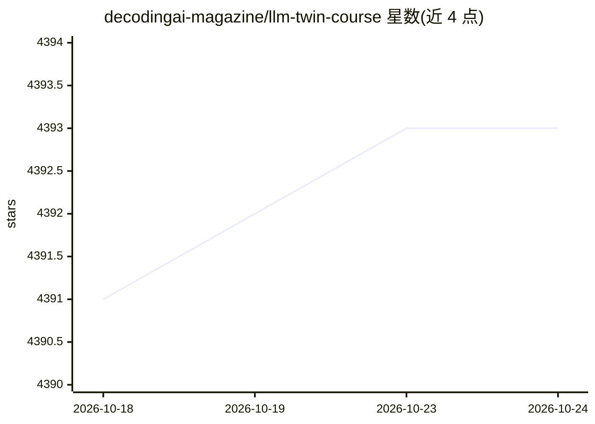

# decodingai-magazine/llm-twin-course

⭐ 4,395 · Python · MIT · 推送 2026-04-20 · [GitHub](https://github.com/decodingai-magazine/llm-twin-course) · 组织维护

**免费开源课程：教你端到端构建生产级 LLM 与 RAG 系统**

由 Decoding AI/Decoding ML 维护的免费自学课程，配 12 篇图文课程与本仓库开源源码，演示如何构建'LLM Twin'（模仿个人写作风格的 AI 角色）系统：数据采集 ETL + CDC、Bytewax 流式特征管道入 Qdrant 向量库、LoRA/QLoRA 微调并经 Comet ML 跟踪与 Opik 评估、部署到 AWS SageMaker 并以 Gradio UI 交互。面向掌握 Python 与机器学习基础的 ML/数据/软件工程师；细调与推理依赖 AWS（课程预计 AWS 费用 < $10、OpenAI API 约 $1）。MIT 许可。

## 筛选速览

| 维度 | 判定 | 备注 |
|---|---|---|
| AI 角色 | `ai-knowledge` | 知识聚合/清单类 |
| 许可风险 | `permissive` | MIT |
| 部署形态 | `None` |  |
| 模型依赖 | — | README 未给出锁定关系 |
| 硬件要求 | — | 无带数字的原话,不猜 |
| 安装摩擦 | `low` | 无编译、无系统依赖或容器化 |
| 成熟度 | — | 结构信号不足 |

## 能力要点

- 4 个 Python 微服务：数据采集、特征管道、训练、推理
- 12 课含 2 节 RAG bonus（Superlinked 重构、多索引 RAG）
- 集成 Comet ML、Qdrant、AWS SageMaker、Opik 四类无服务器工具
- 代码与文章均免费开放，自定节奏学习

## 适用场景

- 系统学习从数据采集到部署的 LLM/RAG 工程实践
- 参考真实项目结构的 LLMOps 源码并复现结果
- 了解 CDC、流式特征管道与 RAG 推理的设计取舍

## 场景标签

`RAG` `教程课程` `微调` `MLOps` · 领域:知识与检索

## 证据(README 行号)

> L11: *By finishing the **"LLM Twin: Building Your Production-Ready AI Replica"** free course, you will learn how to desi
> L105: As an open-source course, you don't have to enroll. Everything is self-paced, free of charge and with its resource
> L119: This self-paced course consists of 12 comprehensive lessons covering theory, system design, and hands-on implement

## 星数曲线

2026-10-18 4,391 → 2026-10-24 4,393（+2）

---
*卡片 v1 · prompt 1.4 · 生成 2026-10-20 · 置信度 high · 依据 README sha `04b95229d10a` · [字段定义](../../DATASET.md)*
