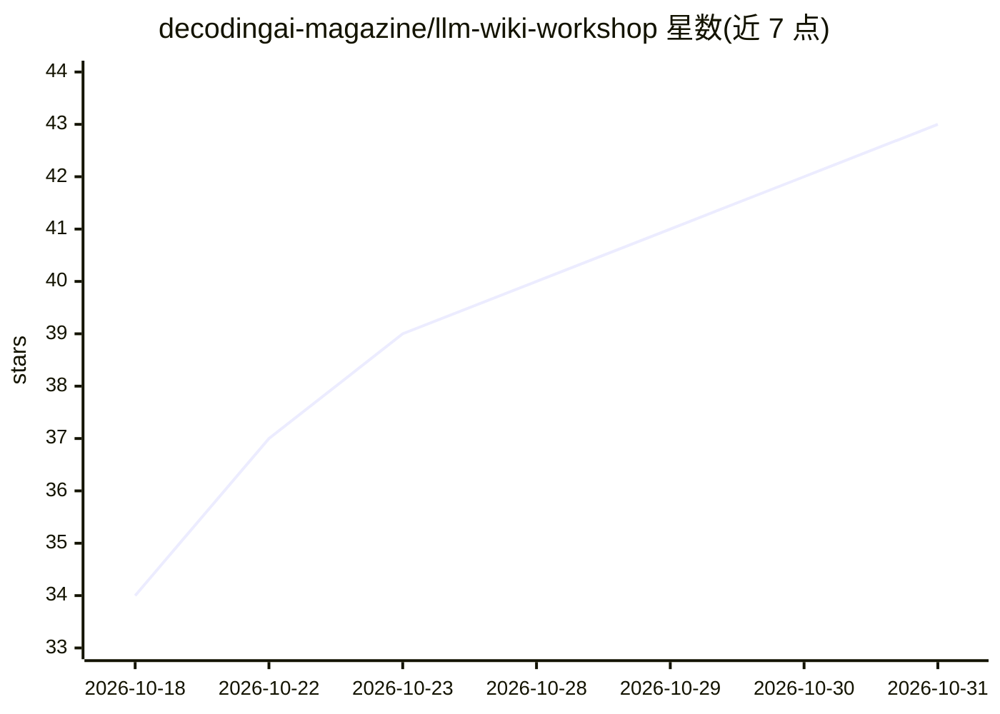

# decodingai-magazine/llm-wiki-workshop

⭐ 43 · Python · MIT · 推送 2026-09-18 · [GitHub](https://github.com/decodingai-magazine/llm-wiki-workshop) · 组织维护

**从第一性原理设计 LLM wiki 的工作坊：3 个练习与开源代码**

面向用过 AI 编程助手、无需编程技能的学习者的开源工作坊（MIT），配套视频与幻灯片。教学对象是“LLM wiki”模式：笔记、仓库、文章、视频等来源进入不可变的 raw/ 层，由 agent 转写为 wiki/ 页面，作为 agent memory 使用。核心机制包括 ≥2 来源阈值决定概念建页、通过分层索引渐进式披露查询、练习 02 引入子代理与适配器做大规模摄取、练习 03 让交互本身驱动知识库增长。可在任意 agent harness 上运行（Claude Code 为参考实现），每练习约 30 分钟。

## 筛选速览

| 维度 | 判定 | 备注 |
|---|---|---|
| AI 角色 | `ai-knowledge` | 知识聚合/清单类 |
| 许可风险 | `permissive` | MIT |
| 部署形态 | `None` |  |
| 模型依赖 | — | README 未给出锁定关系 |
| 硬件要求 | — | 无带数字的原话,不猜 |
| 安装摩擦 | `low` | 无编译、无系统依赖或容器化 |
| 成熟度 | — | 结构信号不足 |

## 能力要点

- raw/ 与 wiki/ 双层结构：不可变原始层 + agent 撰写页，每条声明带 [[wikilink]] 溯源
- ≥2 来源阈值决定概念建页，避免词条堆积
- 练习 02 的子代理扇出摄取：任意带 URI 的对象（本地文件/GitHub 仓库/网页文章）可作为来源
- 练习 03 将提问、笔记、开放问题纳入 wiki，交互驱动知识库增长

## 适用场景

- 我想学习如何为 AI agent 构建可增量维护的 wiki 记忆
- 我想把自己的笔记、仓库和文章整合成带溯源的知识库
- 我想通过可运行的渐进式练习理解 agent memory 设计模式

## 场景标签

`Agent 记忆` `教程课程` · 领域:Agent 开发

## 证据(README 行号)

> L7:  Open-source workshop
> L61: 3. **Work through all three exercises. ~2–3 h.** Exercises 01 and 02 start from
> L137: |**Skills**|Comfortable in a terminal. No coding required — you only type prompts.|

## 星数曲线

2026-10-18 34 → 2026-10-31 43（+9）

---
*卡片 v1 · prompt 1.4 · 生成 2026-10-25 · 置信度 high · 依据 README sha `447c52678708` · [字段定义](../../DATASET.md)*
