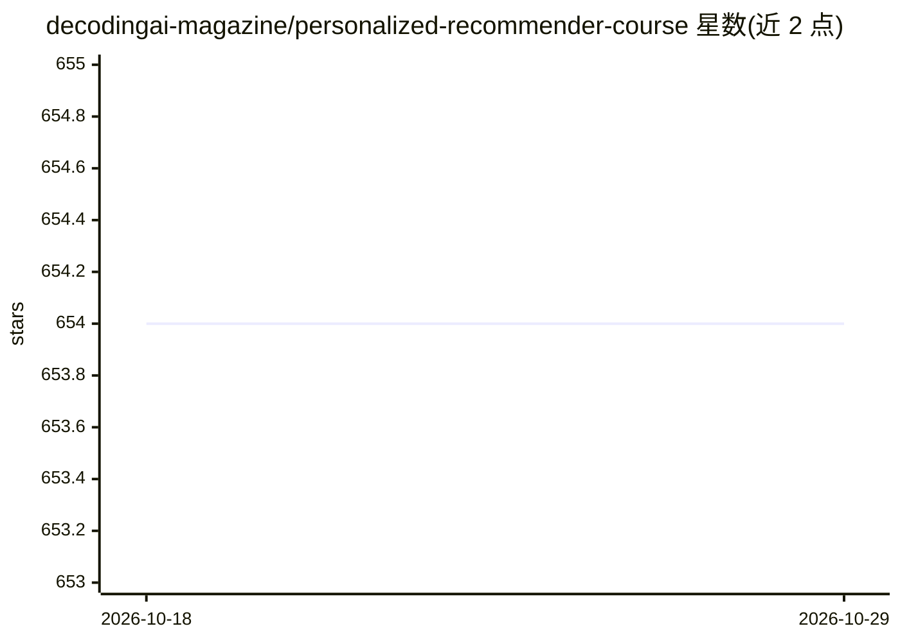

# decodingai-magazine/personalized-recommender-course

⭐ 654 · Jupyter Notebook · MIT · 推送 2026-04-06 · [GitHub](https://github.com/decodingai-magazine/personalized-recommender-course) · 组织维护

**H&M 实时个性化推荐系统的开源实战课程**

由 Decoding AI 与 Hopsworks 合作的 5 模块开源自定进度课程，教读者从零架构、构建并部署面向 H&M 时尚商品的实时个性化推荐系统：基于 Feature/Training/Inference 架构与 4 阶段推荐设计，覆盖 Polars 特征工程、双塔网络训练、向量数据库、特征库与模型注册等 MLOps 实践、KServe 部署到 Kubernetes，以及用 LLM 增强推荐。课程含代码、Notebook 与配套文章，面向有一定 Python/ML 基础的工程师，无需 GPU，多数模块免费，第 5 模块可选使用 OpenAI API（约 $1-2）。

## 筛选速览

| 维度 | 判定 | 备注 |
|---|---|---|
| AI 角色 | `ai-knowledge` | 知识聚合/清单类 |
| 许可风险 | `permissive` | MIT |
| 部署形态 | `None` |  |
| 模型依赖 | — | README 未给出锁定关系 |
| 硬件要求 | — | 无带数字的原话,不猜 |
| 安装摩擦 | `medium` | 含编译或系统依赖之一 |
| 成熟度 | — | 结构信号不足 |

## 能力要点

- 5 模块覆盖架构、特征/训练/推理流水线与 LLM 增强
- FTI 架构 + 4 阶段推荐设计 + 双塔网络实现
- Hopsworks 特征库/模型注册 + KServe 部署到 Kubernetes
- 无需 GPU，支持 Google Colab 与 GitHub Actions 运行

## 适用场景

- 学习并复现一个端到端实时推荐系统的完整工程实现
- 掌握特征库、模型注册、KServe 等生产级 MLOps 实践
- 了解如何用 LLM 技术增强个性化推荐

## 场景标签

`推荐系统` `教程课程` `MLOps` · 领域:学习与行业

## 证据(README 行号)

> L10: This hands-on course teaches you how to build and deploy a real-time personalized recommender system for H&M fashio
> L92: As an open-source course, you don't have to enroll. Everything is self-paced, free of charge and with its resources

## 星数曲线

2026-10-18 654 → 2026-10-29 654（+0）

---
*卡片 v1 · prompt 1.4 · 生成 2026-10-21 · 置信度 high · 依据 README sha `af5ead83e0e5` · [字段定义](../../DATASET.md)*
