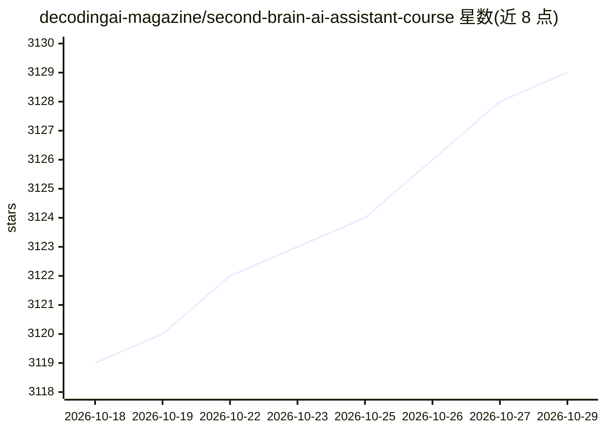

# decodingai-magazine/second-brain-ai-assistant-course

⭐ 3,129 · Jupyter Notebook · MIT · 推送 2026-04-06 · [GitHub](https://github.com/decodingai-magazine/second-brain-ai-assistant-course) · [官网](https://decodingml.substack.com/p/build-your-second-brain-ai-assistant) · 组织维护

**开源课程：构建基于 RAG、Agent 与 LLMOps 的第二大脑 AI 助手**

Decoding AI 与 MongoDB、Comet、Opik、Unsloth、ZenML 协作推出的免费开源课程，含 6 个模块，教授从零构建生产级 agentic RAG 与 LLM 系统：以 Notion 个人知识库为数据源，完成数据 ETL 与质量评分、蒸馏数据集生成、Llama 3.1 8B 微调与部署、上下文/父级检索 RAG，以及推理监控。仓库提供 apps/second-brain-offline 与 apps/second-brain-online 两个 Python 应用，Notion 数据快照放在公开 S3 桶，无需 Notion 账号。面向 ML/AI 工程师等中级学员，运行代码约需 $1-$5 的 API 费用，MIT 许可。

## 筛选速览

| 维度 | 判定 | 备注 |
|---|---|---|
| AI 角色 | `ai-knowledge` | 知识聚合/清单类 |
| 许可风险 | `permissive` | MIT |
| 部署形态 | `None` |  |
| 模型依赖 | — | README 未给出锁定关系 |
| 硬件要求 | — | 无带数字的原话,不猜 |
| 安装摩擦 | `medium` | 含编译或系统依赖之一 |
| 成熟度 | — | 结构信号不足 |

## 能力要点

- 6 模块覆盖数据管道、微调、RAG、agentic 推理与 LLMOps 监控
- 微调 Llama 3.1 8B 并部署为实时 API 端点
- 两个 Python 应用（离线 ML 管道 + 在线推理助手）随仓库提供
- Notion 数据快照公开于 S3，无需 Notion 账号即可完成课程

## 适用场景

- 通过动手构建项目学习生产级 agentic RAG 系统
- 获得可复用的 LLM/RAG 代码模板开发个人 GenAI 应用
- 学习微调、部署与 LLMOps 评估的完整流程

## 场景标签

`教程课程` `RAG` `微调` `MLOps` · 领域:知识与检索

## 证据(README 行号)

> L11: This course is part of Decoding AI's open-source series, teaching you how to build production-ready GenAI systems u
> L13: **The Second Brain AI Assistant** course contains **6 modules** that will teach you how to build an **advanced RAG 
> L107: As an open-source course, you don't have to enroll. Everything is self-paced, free of charge and with its resource

## 星数曲线

2026-10-18 3,119 → 2026-10-29 3,129（+10）

---
*卡片 v1 · prompt 1.4 · 生成 2026-10-20 · 置信度 high · 依据 README sha `db5743fe5564` · [字段定义](../../DATASET.md)*
