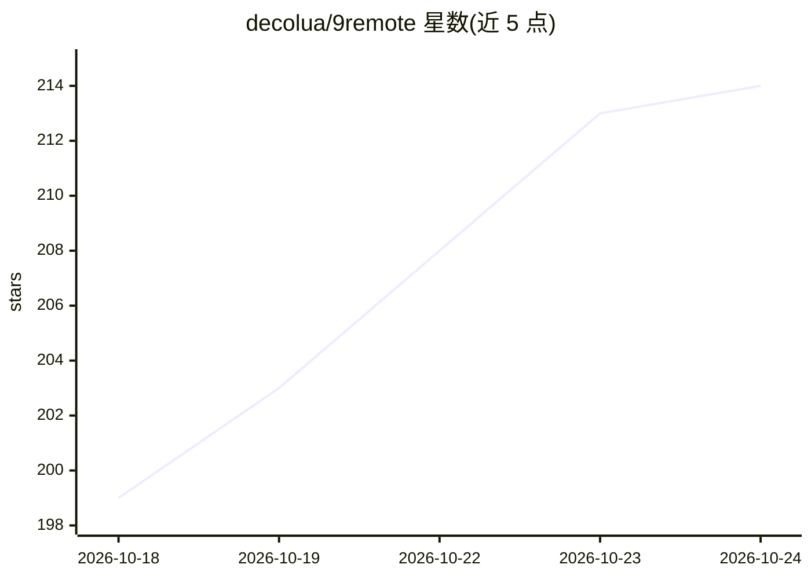

# decolua/9remote

⭐ 215 · JavaScript · Apache-2.0 · 推送 2026-10-23 · [GitHub](https://github.com/decolua/9remote) · [官网](https://9remote.cc) · 组织维护

**手机/浏览器远程操控电脑终端与 AI 编码代理的工具**

由 Node.js host（npm 包 9remote）、Next.js 网页端、Tauri 桌面壳构成的 monorepo：在电脑上运行 host 后，经 WebRTC/WebSocket 加密隧道从手机、浏览器、iPad 或桌面客户端访问 PTY 终端、可视化文件管理器、多面板远程 IDE、60fps 桌面串流、Android/iOS 模拟器远程画面与 localhost 预览。可在单一 UI 中运行 Claude Code、Codex、Gemini CLI 等 30+ AI 代理并查看其产物。采用分割密钥配对与主机物理批准的零信任安全架构；自托管网页端需绑定 Cloudflare Workers（D1/KV/R2），host 本身仅需 Node 环境。

## 筛选速览

| 维度 | 判定 | 备注 |
|---|---|---|
| AI 角色 | `ai-enhanced` | 去掉 AI 部分产品仍成立 |
| 许可风险 | `permissive` | Apache-2.0 |
| 部署形态 | `desktop` | 安装包/桌面程序 |
| 模型依赖 | — | README 未给出锁定关系 |
| 硬件要求 | — | 无带数字的原话,不猜 |
| 安装摩擦 | `low` | 无编译、无系统依赖或容器化 |
| 成熟度 | — | 结构信号不足 |

## 能力要点

- 单一 UI 运行 Claude Code、Codex、Gemini CLI 等 30+ AI 代理，带实时产物查看器
- 60fps WebRTC 远程桌面与多面板终端、代码编辑器、Git diff 视图
- 分割密钥配对 + X25519/AES-256-GCM 加密 + 主机物理批准的零信任架构
- 后台 PTY 守护进程在网络切换或关闭标签页后保持 shell 与构建存活

## 适用场景

- 通勤或外出时用手机继续操控电脑上的编码代理和终端
- 在移动设备上远程查看 Android 模拟器/iOS 模拟器画面
- 无需端口转发即可在手机浏览器预览本机 localhost 服务
- 跨设备安全管理远程文件与长时间运行的任务

## 场景标签

 · 领域:远程开发工具

## 证据(README 行号)

> L3: Your entire dev workstation in your pocket. A remote IDE, 60fps desktop stream, visual file explorer, live mobile em
> L49: 1. **Every Harness, One UI:** Run Claude Code, Codex, Gemini CLI, Cursor CLI, Aider & 30+ AI agents in a single UI,
> L51: 3. **60fps Remote Desktop:** Ultra-smooth screen streaming with hardware acceleration and <20ms latency over direct

## 星数曲线

2026-10-18 199 → 2026-10-24 214（+15）

---
*卡片 v1 · prompt 1.4 · 生成 2026-10-22 · 置信度 high · 依据 README sha `bbcd89f9198a` · [字段定义](../../DATASET.md)*
