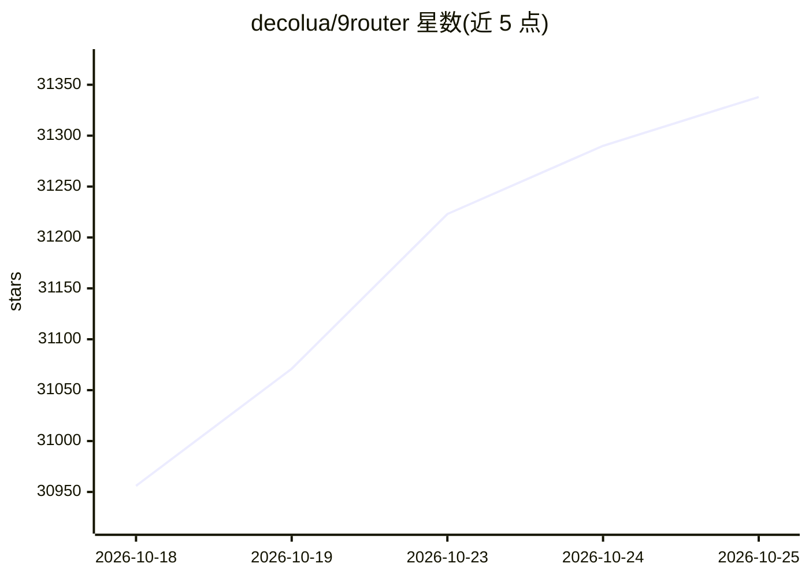

# decolua/9router

⭐ 31,338 · JavaScript · MIT · 推送 2026-10-23 · [GitHub](https://github.com/decolua/9router) · [官网](https://9router.com) · 个人维护

**为 AI 编码 CLI 工具聚合 40+ 模型提供商的本地路由网关**

本地运行的 AI 模型路由网关：将 Claude Code、Codex、Cursor、Cline 等 CLI 编码工具统一接入 40+ 提供商与 100+ 模型，暴露 OpenAI 兼容端点（localhost:20128/v1）。核心机制包括 RTK 令牌压缩（对 git diff/grep 等工具输出做无损压缩）、订阅→低价→免费的三级自动回退、多账号轮询、配额实时追踪与 OAuth 令牌自动刷新。通过 npm 全局安装或源码/Docker 运行，提供 Web Dashboard 管理。

## 筛选速览

| 维度 | 判定 | 备注 |
|---|---|---|
| AI 角色 | `ai-ecosystem` | LLM/agent 周边工具 |
| 许可风险 | `permissive` | MIT |
| 部署形态 | `self-host` | docker 或自建部署 |
| 模型依赖 | local-ok | 支持本地模型 |
| 硬件要求 | — | 无带数字的原话,不猜 |
| 安装摩擦 | `low` | 无编译、无系统依赖或容器化 |
| 成熟度 | — | 结构信号不足 |

## 动量与使用信号

- 维护:`active` — 距上次 push 2.8 天,年发版 73,333 位贡献者
- 涨星:近 1 天 **+66**(自 20261016 起算)
- 安装:npm 包 `9router` 月下载 234,070
- 平台:— · 协议:OPENAI-API / OLLAMA

## 能力要点

- RTK 工具输出压缩，声明节省 20-40% 输入令牌
- 订阅→低价→免费的三级自动回退路由
- OpenAI/Claude/Gemini/Cursor/Kiro/Vertex 间格式转换
- 自托管 STT/TTS/Embedding 提供商接入与 baseUrl 配置

## 适用场景

- 让 Claude Code/Cursor 等 CLI 工具使用免费或低价模型端点
- 订阅配额用尽时自动切换到备用模型不停工
- 多个提供商账号间做轮询负载分摊
- 本地 whisper.cpp/vLLM 等自托管语音与嵌入服务统一接入

## 场景标签

`模型网关` · 领域:Agent 开发

## 证据(README 行号)

> L7:  **Connect All AI Code Tools (Claude Code, Cursor, Antigravity, Copilot, Codex, Gemini, OpenCode, Cline, OpenClaw...
> L53: npm install -g 9router
> L387: |🎯 **Smart 3-Tier Fallback**|Auto-route: Subscription → Cheap → Free|Never stop coding, zero downtime|

## 星数曲线

2026-10-18 30,956 → 2026-10-25 31,338（+382）

---
*卡片 v1 · prompt 1.4 · 生成 2026-10-18 · 置信度 mid · 依据 README sha `44ab217afe50` · [字段定义](../../DATASET.md)*
