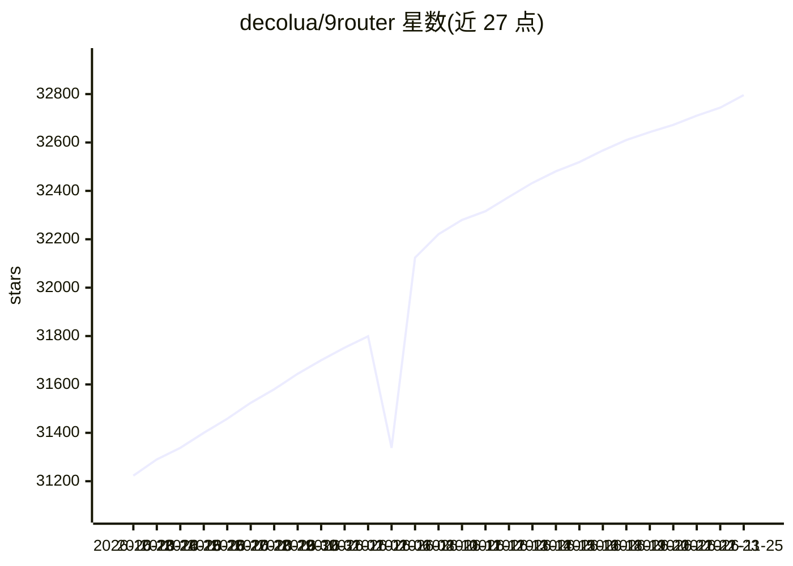

# decolua/9router

⭐ 32,796 · JavaScript · MIT · 推送 2026-11-23 · [GitHub](https://github.com/decolua/9router) · [官网](https://9router.com) · 个人维护 · 中文 README

**本地 AI 路由器：为 CLI 编码工具接入 40+ 免费与付费模型源**

9Router 以 npm 包或源码/Docker 方式运行于 localhost:20128，提供 OpenAI 兼容端点，将 Claude Code、Codex、Cursor、Cline 等 CLI 编码工具接入 OAuth、免费与 API Key 三类共 40+ 模型提供商。核心机制包括 RTK 工具输出压缩（自动检测 git diff/grep 等输出并无损压缩）、订阅→低价→免费的三层自动回退、多账号轮询、格式互译（OpenAI↔Claude↔Gemini↔Cursor 等）与配额实时跟踪。支持自托管 STT/TTS/Embedding 端点，可部署到 VPS、Docker、Cloudflare Workers。

## 筛选速览

| 维度 | 判定 | 备注 |
|---|---|---|
| AI 角色 | `ai-ecosystem` | LLM/agent 周边工具 |
| 许可风险 | `permissive` | MIT |
| 部署形态 | `self-host` | docker 或自建部署 |
| 模型依赖 | local-ok | 支持本地模型 |
| 硬件要求 | — | 无带数字的原话,不猜 |
| 安装摩擦 | `low` | 无编译、无系统依赖或容器化 |
| 成熟度 | — | 结构信号不足 |

## 动量与使用信号

- 维护:`active` — 距上次 push 2.8 天,年发版 73,333 位贡献者
- 涨星:近 1 天 **+66**(自 20261016 起算)
- 安装:npm 包 `9router` 月下载 234,070
- 平台:— · 协议:OPENAI-API / OLLAMA

## 能力要点

- RTK Token Saver：自动检测并压缩工具输出，声称每请求节省 20-40% 输入 token
- 订阅→低价→免费三层自动回退与多账号轮询
- OpenAI↔Claude↔Gemini↔Cursor↔Kiro↔Vertex 格式互译
- 自托管 STT/TTS/Embedding 端点支持（whisper.cpp、llama-server、vLLM 等）

## 适用场景

- 让 Claude Code/Cline 等工具在订阅配额耗尽时自动切换到免费模型
- 为多个 AI CLI 工具统一配置本地网关端点
- 压缩 git diff 等工具输出以减少发送给 LLM 的 token
- 在本地/自托管环境接入语音与嵌入服务

## 场景标签

`模型网关` · 领域:Agent 开发

## 证据(README 行号)

> L7:  **Connect All AI Code Tools (Claude Code, Cursor, Antigravity, Copilot, Codex, Gemini, OpenCode, Cline, OpenClaw...
> L33: - ✅ **RTK Token Saver** - Auto-compress tool_result content, save 20-40% tokens per request
> L96: - OpenAI-compatible API: `http://localhost:20128/v1`

## 星数曲线

2026-10-23 31,223 → 2026-11-25 32,796（+1,573）

---
*卡片 v1 · prompt 1.4 · 生成 2026-11-22 · 置信度 mid · 依据 README sha `441007d358aa` · [字段定义](../../DATASET.md)*
