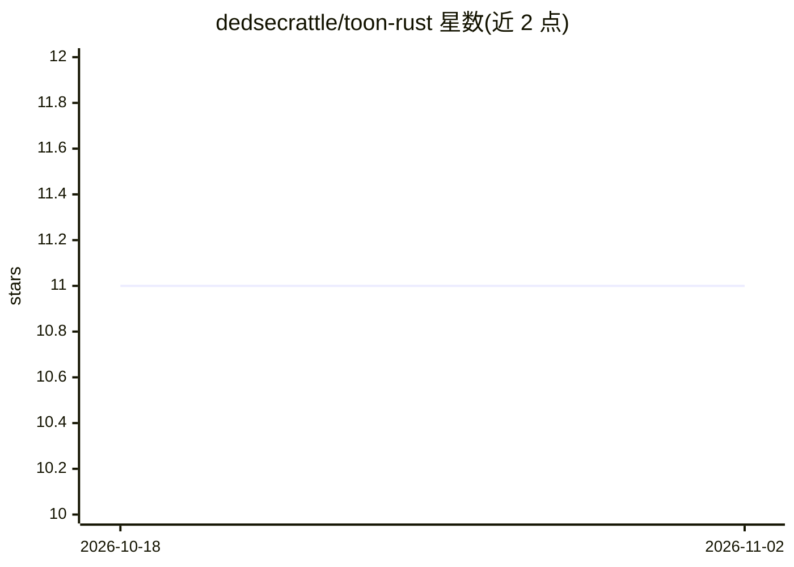

# dedsecrattle/toon-rust

⭐ 11 · Rust · MIT · 推送 2026-04-10 · [GitHub](https://github.com/dedsecrattle/toon-rust) · [官网](https://dedsecrattle.github.io/toon-rust/) · 个人维护

**TOON 格式的 Rust 编解码库：为 LLM 提示压缩 token**

Token-Oriented Object Notation (TOON) 规范 v1.4 的 Rust 实现，作为库提供，宣称相比 JSON 可减少 LLM 提示中 30–60% 的 token 用量。提供两条 API 路径：基于 serde_json::Value 的独立 API 与 Serde 兼容 API，另有流式编解码（可处理超过内存的大文件）、SIMD 优化的表格数组解析（x86_64 SSE2，自动回退）、可自定义分隔符与长度标记、严格校验模式。通过 Cargo.toml 依赖安装，MIT 许可。

## 筛选速览

| 维度 | 判定 | 备注 |
|---|---|---|
| AI 角色 | `ai-ecosystem` | LLM/agent 周边工具 |
| 许可风险 | `permissive` | MIT |
| 部署形态 | `library` | 以包/库形式分发 |
| 模型依赖 | — | README 未给出锁定关系 |
| 硬件要求 | — | 无带数字的原话,不猜 |
| 安装摩擦 | `low` | 无编译、无系统依赖或容器化 |
| 成熟度 | — | 结构信号不足 |

## 能力要点

- TOON 规范 v1.4 完整支持，独立与 Serde 两套 API
- 流式编解码 API，可处理大于内存的数据集
- x86_64 SSE2 SIMD 优化表格数组解析，自动回退标量实现
- 分隔符（逗号/Tab/竖线）、长度标记与缩进可配置

## 适用场景

- 在 Rust 项目中把结构化数据编码为 TOON 以压缩 LLM 提示 token
- 流式处理大型数据文件的 TOON 编解码
- 解码 LLM 输出的 TOON 格式数据并映射到 Serde 类型

## 场景标签

`提示工程` · 领域:Agent 开发

## 证据(README 行号)

> L13: > **TOON** is a compact, human-readable format designed to reduce token usage in Large Language Model (LLM) prompts
> L17: - ✅ Full TOON specification v1.4 support

## 星数曲线

2026-10-18 11 → 2026-11-02 11（+0）

---
*卡片 v1 · prompt 1.4 · 生成 2026-11-02 · 置信度 high · 依据 README sha `bf2729e14d3a` · [字段定义](../../DATASET.md)*
