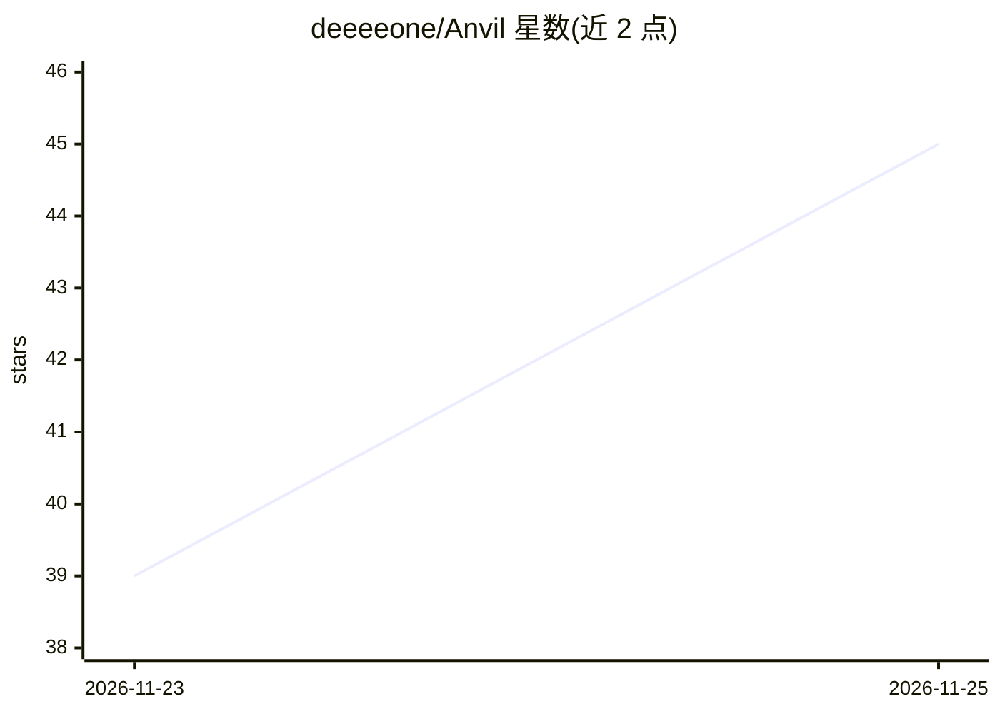

# deeeeone/Anvil

⭐ 45 · Swift · AGPL-3.0 · 推送 2026-11-23 · [GitHub](https://github.com/deeeeone/Anvil) · 个人维护

**macOS 原生编码 agent：任意模型驱动的本地代码修改工具**

用 SwiftUI 构建的 macOS 桌面编码 agent：打开文件夹、描述改动，agent 读取、编辑、运行命令与测试直到完成。通过纯文本协议（JSON 动作块）而非原生 tool calling 与任意聊天模型通信，因此可接入任何 OpenAI 兼容 API、ChatGPT/Gemini 网页账号或社区插件。内置 diff 审查、checkpoint 回滚、四种权限模式、测试先于完成判定、二次审查与失败后换模型家族等校验机制。需 macOS 15+ 与 Xcode 26+，目前仅支持从源码构建。

## 筛选速览

| 维度 | 判定 | 备注 |
|---|---|---|
| AI 角色 | `ai-native` | 本体是模型或模型工具 |
| 许可风险 | `viral` | AGPL-3.0 |
| 部署形态 | `None` |  |
| 模型依赖 | local-ok | 支持本地模型 |
| 硬件要求 | — | 无带数字的原话,不猜 |
| 安装摩擦 | `medium` | 含编译或系统依赖之一 |
| 成熟度 | — | 结构信号不足 |

## 能力要点

- 纯文本 JSON 协议接入任意聊天模型，无需原生 tool calling
- 每个编辑先出 diff、每请求有 checkpoint 可撤销，四种权限模式
- 子会话在独立 git worktree 并行运行后合并
- 内置终端、可驱动的浏览器预览与 iOS Simulator 工具，支持 MCP (stdio)

## 适用场景

- 让 agent 自动修复 bug 并补测试，逐条审查 diff 后应用
- 把功能拆成多个子会话在独立 worktree 并行开发
- 用 ChatGPT/Gemini 网页账号或本地 Ollama 驱动编码任务
- 通过 headless CLI 在脚本和评测中运行同一 agent

## 场景标签

`编码 Agent` · 领域:编码与开发

## 证据(README 行号)

> L5: **A native macOS coding agent that works with almost any model.**
> L17: Anvil is a desktop app in the spirit of Claude Code and Codex, built natively for the Mac with SwiftUI. Its agent s
> L133: **Settings → Provider → Add provider** offers ready-made presets for **Z.ai, OpenRouter, Groq, DeepSeek, Mistral, 

## 星数曲线

2026-11-23 39 → 2026-11-25 45（+6）

---
*卡片 v1 · prompt 1.4 · 生成 2026-11-23 · 置信度 high · 依据 README sha `56d558379132` · [字段定义](../../DATASET.md)*
