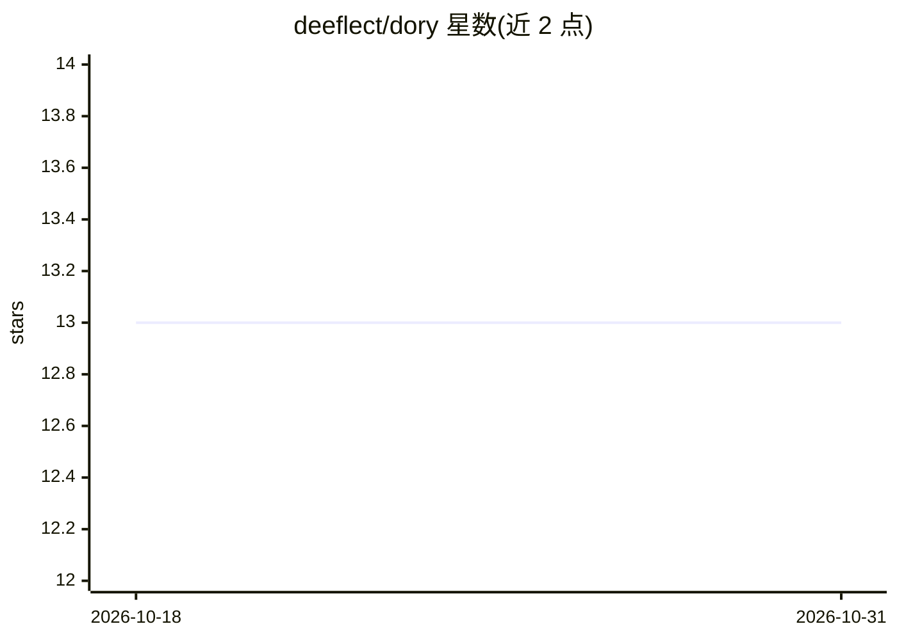

# deeflect/dory

⭐ 13 · Python · MIT · 推送 2026-06-10 · [GitHub](https://github.com/deeflect/dory) · [官网](https://dory.deeflect.com) · 个人维护

**面向多 AI agent 的本地优先共享记忆守护进程**

Dory 是一个本地优先的记忆守护进程（daemon），为 Claude、Codex、opencode、OpenClaw、Hermes 等多个 agent 提供统一的记忆层。以 Markdown 为事实源，SQLite 作为可丢弃的旁路存储；agent 通过 CLI、HTTP API 与原生 MCP 接口执行 wake/search/get/memory-write/link 五个核心操作，实现跨工具共享记忆。嵌入默认用 Gemini，可切换 OpenAI 兼容本地端点；记忆 LLM 可选 Ollama/LM Studio/vLLM。需 Python 3.12+，通过 uv 或 Docker Compose 部署，语料库需自行填充，含迁移与运维作业。MIT 许可，由个人开发者维护。

## 筛选速览

| 维度 | 判定 | 备注 |
|---|---|---|
| AI 角色 | `ai-ecosystem` | LLM/agent 周边工具 |
| 许可风险 | `permissive` | MIT |
| 部署形态 | `self-host` | docker 或自建部署 |
| 模型依赖 | local-ok | 支持本地模型 |
| 硬件要求 | — | 无带数字的原话,不猜 |
| 安装摩擦 | `low` | 无编译、无系统依赖或容器化 |
| 成熟度 | — | 结构信号不足 |

## 能力要点

- Markdown 为事实源，SQLite 仅作旁路索引，语料可用 git diff 与 Obsidian 编辑
- CLI / HTTP daemon / 原生 MCP（stdio 与 tcp）三种接入面
- wake→search→get→memory-write→link 的核心操作循环与混合检索
- 嵌入支持 Gemini 或 OpenAI 兼容本地端点，记忆 LLM 可接 Ollama/LM Studio/vLLM

## 适用场景

- 让多个编码 agent 共享同一份用户偏好与项目状态记忆
- 为 Claude Code 等 MCP 客户端挂载持久记忆后端
- 以 Docker 服务形式在局域网主机上运行统一记忆层

## 场景标签

`Agent 记忆` · 领域:Agent 开发

## 证据(README 行号)

> L29: A **local-first memory daemon** that gives every agent the same brain.
> L31: Markdown is the source of truth. SQLite is a disposable sidecar. Agents read and write through a narrow API — `wake
> L96: |**HTTP daemon**|`/v1/wake`, `/v1/active-memory`, `/v1/search`, `/v1/research`, `/v1/get`, `/v1/write`, `/v1/memory

## 星数曲线

2026-10-18 13 → 2026-10-31 13（+0）

---
*卡片 v1 · prompt 1.4 · 生成 2026-10-31 · 置信度 high · 依据 README sha `ba1f3d333c0e` · [字段定义](../../DATASET.md)*
