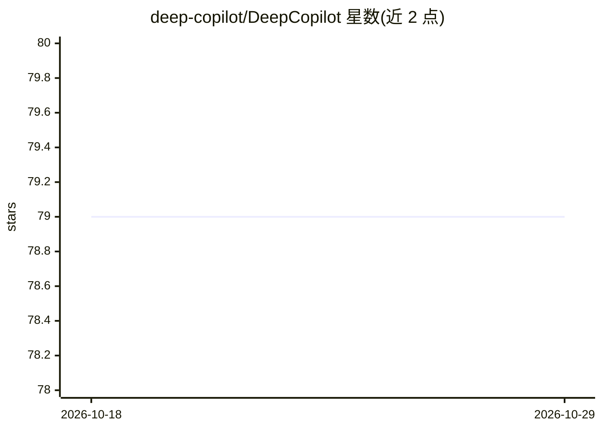

# deep-copilot/DeepCopilot

⭐ 79 · JavaScript · MIT · 推送 2026-09-04 · [GitHub](https://github.com/deep-copilot/DeepCopilot) · [官网](https://marketplace.visualstudio.com/items?itemName=ZhouChaunge.deep-copilot) · 个人维护 · 中文 README

**VS Code 侧边栏 AI 编程助手：DeepSeek 驱动的对话式 Agent**

基于 VS Code Extension API 的对话式 AI 编程助手扩展，通过 DeepSeek API（OpenAI 兼容协议）与模型交互，支持多轮 tool-calling 循环：文件读写、精准替换、ripgrep 搜索、Shell 命令执行、Tavily 联网搜索（可选 Key），结果流式渲染。面向使用 VS Code 的开发者，需自备 DeepSeek API Key。提供四种审批模式（手动/自动编辑/全自动/只读）、MCP 客户端、技能系统与行内补全。无运行时 npm 依赖，无需额外部署服务；可从扩展商城或 VSIX 安装。

## 筛选速览

| 维度 | 判定 | 备注 |
|---|---|---|
| AI 角色 | `ai-native` | 本体是模型或模型工具 |
| 许可风险 | `permissive` | MIT |
| 部署形态 | `library` | 以包/库形式分发 |
| 模型依赖 | locked-api |  |
| 硬件要求 | — | 无带数字的原话,不猜 |
| 安装摩擦 | `low` | 无编译、无系统依赖或容器化 |
| 成熟度 | — | 结构信号不足 |

## 能力要点

- 多轮 tool-calling 循环：文件读写、代码搜索、Shell 执行、联网搜索
- 四种审批模式与一键回滚、待审编辑面板
- MCP 客户端连接任意 MCP 工具服务器，SKILL.md 技能包系统
- 无运行时 npm 依赖，基于 VS Code Extension API 与 Node.js 内置模块

## 适用场景

- 在 VS Code 里通过对话让 Agent 完成编辑、搜索与命令执行等编程任务
- 以只读 Plan 模式调查代码结构后再执行修改
- 通过 MCP 与技能包扩展 Agent 的可调用工具范围

## 场景标签

`编码 Agent` · 领域:编码与开发

## 证据(README 行号)

> L14: > Deep Copilot 是一个 VS Code 扩展，在侧边栏提供基于大语言模型的对话式编程辅助。它通过 DeepSeek API（兼容 OpenAI 协议）与模型交互，支持文件读写、代码搜索、Shell 命令执行等工具调用
> L51: |**Agentic loop** with multi-turn tool calling on DeepSeek V4 (Pro / Flash / Reasoner)|与 DeepSeek V4（Pro / Flash / 
> L86: 1. Open VS Code → Extensions (`Ctrl/Cmd+Shift+X`) → Search **Deep Copilot** → Install.

## 星数曲线

2026-10-18 79 → 2026-10-29 79（+0）

---
*卡片 v1 · prompt 1.4 · 生成 2026-10-24 · 置信度 mid · 依据 README sha `b1f5617887a3` · [字段定义](../../DATASET.md)*
