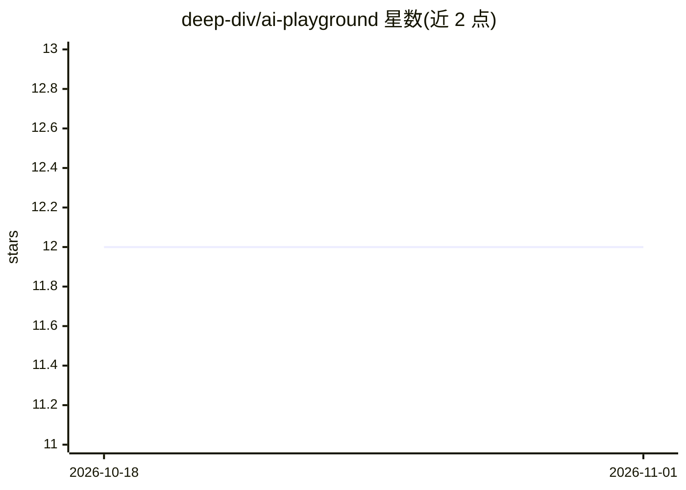

# deep-div/ai-playground

⭐ 12 · Jupyter Notebook · Apache-2.0 · 推送 2026-09-19 · [GitHub](https://github.com/deep-div/ai-playground) · 个人维护

**深度学习实战代码示例集：用可运行代码学习 ANN/CNN/RNN**

个人维护的深度学习代码示例仓库：以 PyTorch 为主（另含 TensorFlow 与 Keras 示例），提供 ANN、CNN、RNN 等核心架构的独立可运行脚本，覆盖真实任务与目标检测等场景。每个文件为独立代码，不含理论阐述，定位是通过动手写代码学习深度学习，也可作为常见深度学习用例的参考，供个人或学术项目直接运行。仓库开放 fork 与 PR 改进。

## 筛选速览

| 维度 | 判定 | 备注 |
|---|---|---|
| AI 角色 | `ai-knowledge` | 知识聚合/清单类 |
| 许可风险 | `permissive` | Apache-2.0 |
| 部署形态 | `None` |  |
| 模型依赖 | — | README 未给出锁定关系 |
| 硬件要求 | — | 无带数字的原话,不猜 |
| 安装摩擦 | `low` | 无编译、无系统依赖或容器化 |
| 成熟度 | — | 结构信号不足 |

## 能力要点

- PyTorch 为主的独立可运行代码示例
- 覆盖 ANN、CNN、RNN 等核心架构
- 面向实战任务而非学术理论

## 适用场景

- 通过动手运行代码学习深度学习架构
- 在个人或学术项目中复用现成脚本
- 查找常见深度学习用例的实现参考

## 场景标签

`教程课程` · 领域:学习与行业

## 证据(README 行号)

> L5: This repo is a curated collection of practical deep learning projects and code examples, built to help you understan
> L11: * Hands-on deep learning code examples

## 星数曲线

2026-10-18 12 → 2026-11-01 12（+0）

---
*卡片 v1 · prompt 1.4 · 生成 2026-11-01 · 置信度 high · 依据 README sha `5071409fb400` · [字段定义](../../DATASET.md)*
