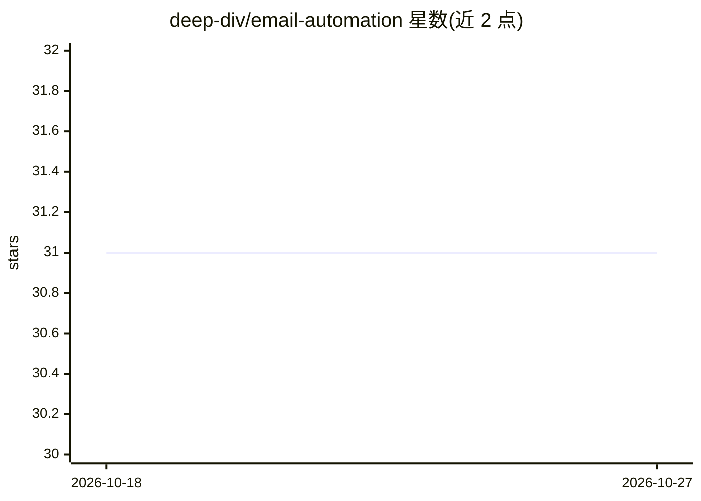

# deep-div/email-automation

⭐ 31 · Python · Apache-2.0 · 推送 2026-09-19 · [GitHub](https://github.com/deep-div/email-automation) · 个人维护

**提取招聘信息并生成个性化求职邮件的自动化工具**

基于 Streamlit 的邮件自动化应用：从招聘信息中提取内容，结合 LangChain 与 Groq API 生成个性化邮件，并附带相关作品集链接。README 仅提供安装运行步骤：配置 Groq API Key、创建 Python 虚拟环境、用 uv 同步依赖后运行 Streamlit 应用。主题标签提及 Docker，但可见文档中无使用说明。功能描述主要来自仓库简介，README 本身未展开机制细节。

## 筛选速览

| 维度 | 判定 | 备注 |
|---|---|---|
| AI 角色 | `ai-native` | 本体是模型或模型工具 |
| 许可风险 | `permissive` | Apache-2.0 |
| 部署形态 | `library` | 以包/库形式分发 |
| 模型依赖 | locked-api |  |
| 硬件要求 | — | 无带数字的原话,不猜 |
| 安装摩擦 | `low` | 无编译、无系统依赖或容器化 |
| 成熟度 | — | 结构信号不足 |

## 能力要点

- 从招聘信息提取内容并生成个性化邮件
- 附带相关作品集链接
- 以 Streamlit Web 应用形式运行

## 适用场景

- 求职者批量生成针对具体职位的个性化邮件
- 自动匹配职位需求与个人作品集链接

## 场景标签

`AI 写作` · 领域:内容生成

## 证据(README 行号)

> L11: **https://console.groq.com/keys**
> L13: Update the `GROQ_API_KEY` value inside `app/.env`.

## 星数曲线

2026-10-18 31 → 2026-10-27 31（+0）

---
*卡片 v1 · prompt 1.4 · 生成 2026-10-26 · 置信度 low · 依据 README sha `6a4c81a963c6` · [字段定义](../../DATASET.md)*
