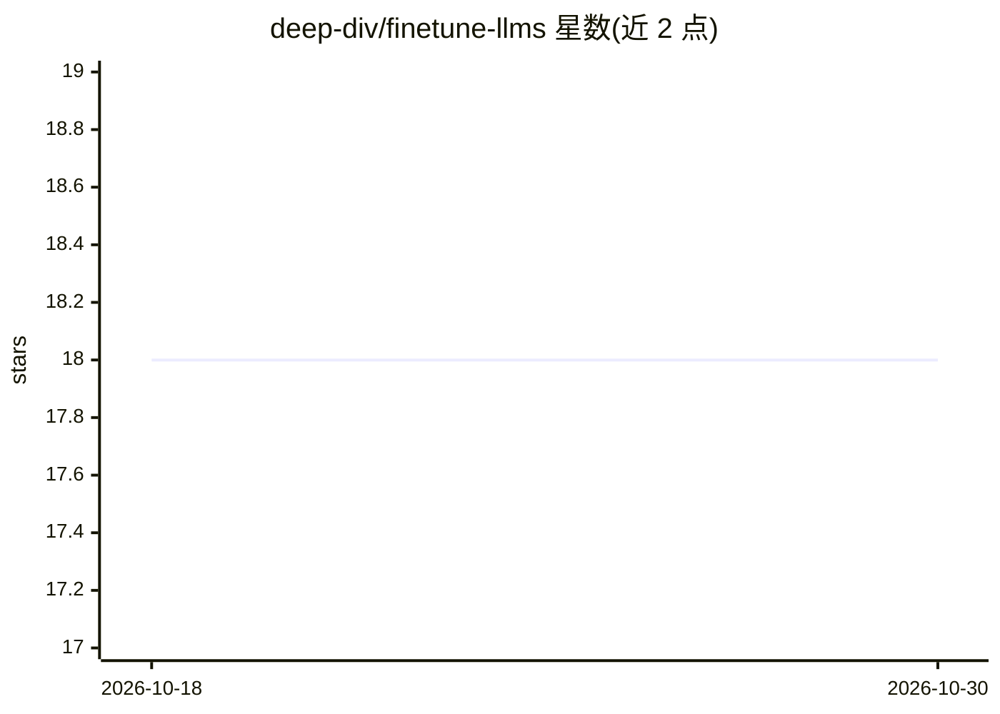

# deep-div/finetune-llms

⭐ 18 · Jupyter Notebook · Apache-2.0 · 推送 2026-09-19 · [GitHub](https://github.com/deep-div/finetune-llms) · 个人维护

**开源 LLM 微调实践指南仓库：Gemma/LLaMA/Mistral 等的微调方法与配置**

面向研究者、ML 工程师与爱好者的微调教程/示例仓库：展示如何使用 Hugging Face Transformers 与 PEFT（LoRA/QLoRA）等库在自定义数据集上微调 Gemma、LLaMA、Mistral 等开源大模型。内容覆盖数据集加载与预处理、tokenization 与模型配置、基于自定义指标的评估、可复现的易编辑配置以及 fp16/bf16 混合精度支持。README 未展示具体安装命令或训练脚本入口。

## 筛选速览

| 维度 | 判定 | 备注 |
|---|---|---|
| AI 角色 | `ai-knowledge` | 知识聚合/清单类 |
| 许可风险 | `permissive` | Apache-2.0 |
| 部署形态 | `None` |  |
| 模型依赖 | — | README 未给出锁定关系 |
| 硬件要求 | — | 无带数字的原话,不猜 |
| 安装摩擦 | `low` | 无编译、无系统依赖或容器化 |
| 成熟度 | — | 结构信号不足 |

## 能力要点

- 使用 Hugging Face Trainer 与 PEFT（LoRA/QLoRA）进行微调
- 覆盖数据集加载、预处理、tokenization 与模型配置
- 基于自定义指标的评估与可复现的配置文件
- 支持 fp16/bf16 混合精度

## 适用场景

- 学习在自定义数据集上微调开源 LLM 的流程
- 参考 LoRA/QLloRA 配置搭建自己的微调实验
- 了解微调中的数据预处理与评估指标实践

## 场景标签

`微调` `教程课程` · 领域:学习与行业

## 证据(README 行号)

> L3: Welcome to this curated repository showcasing the fine-tuning of various open-source large language models (LLMs) su
> L5: This repo is designed for researchers, ML engineers, and enthusiasts looking to explore or build on top of custom fi

## 星数曲线

2026-10-18 18 → 2026-10-30 18（+0）

---
*卡片 v1 · prompt 1.4 · 生成 2026-10-29 · 置信度 high · 依据 README sha `43935b4237f8` · [字段定义](../../DATASET.md)*
