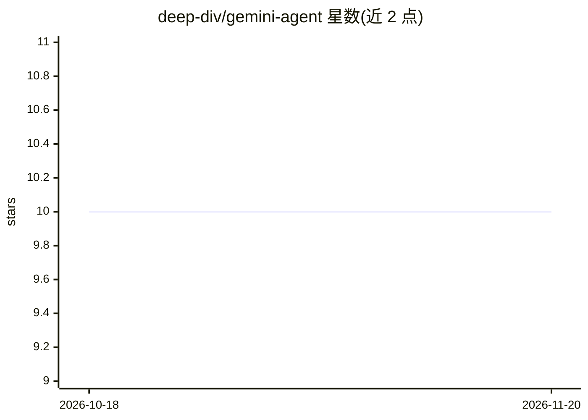

# deep-div/gemini-agent

⭐ 10 · Python · 推送 2026-09-19 · [GitHub](https://github.com/deep-div/gemini-agent) · 个人维护

**基于 Gemini 的模块化 AI Agent 框架，带 Streamlit 网页界面**

以 Gemini 为后端的模块化 Agent 框架，通过 Streamlit 提供网页界面。功能包括模块化工具定义与选择、函数调用/工具交互、会话历史管理与可自定义系统提示词。README 给出克隆仓库、pip 安装依赖、激活虚拟环境、运行 Streamlit 应用的完整流程，要求 Python 3.10+。项目采用 MIT 许可，README 同时说明其定位为演示 Gemini 工具用法与真实集成示例的实践代码手册。

## 筛选速览

| 维度 | 判定 | 备注 |
|---|---|---|
| AI 角色 | `ai-ecosystem` | LLM/agent 周边工具 |
| 许可风险 | `none` | — |
| 部署形态 | `library` | 以包/库形式分发 |
| 模型依赖 | — | README 未给出锁定关系 |
| 硬件要求 | — | 无带数字的原话,不猜 |
| 安装摩擦 | `low` | 无编译、无系统依赖或容器化 |
| 成熟度 | — | 结构信号不足 |

## 能力要点

- 模块化工具定义与选择机制
- Gemini LLM 集成与会话历史管理
- Streamlit 网页界面，可自定义系统提示词

## 适用场景

- 学习/演示 Gemini 函数调用与工具使用流程
- 搭建基于工具调用的对话式任务执行界面
- 作为集成示例参考改造自己的 Agent 应用

## 场景标签

`Agent 框架` · 领域:Agent 开发

## 证据(README 行号)

> L5: A modular AI agent framework powered by Gemini, designed to enable tool-based interactions and intelligent task exec
> L67: * Gemini LLM integration

## 星数曲线

2026-10-18 10 → 2026-11-20 10（+0）

---
*卡片 v1 · prompt 1.4 · 生成 2026-11-19 · 置信度 high · 依据 README sha `11f57786aa6f` · [字段定义](../../DATASET.md)*
