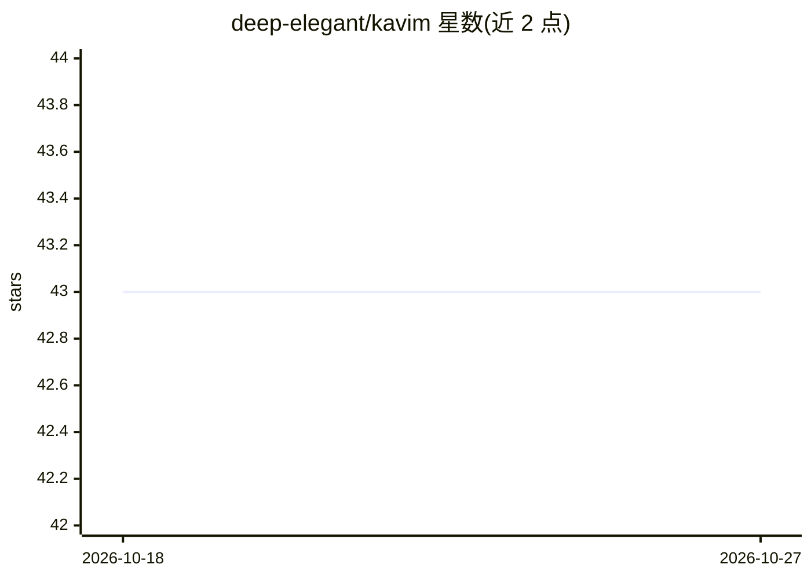

# deep-elegant/kavim

⭐ 43 · TypeScript · NOASSERTION · 推送 2025-12-11 · [GitHub](https://github.com/deep-elegant/kavim) · [官网](https://kavim.deepelegant.com/) · 组织维护

**本地优先的私密多人实时头脑风暴画布，可接入自有 AI**

基于 Electron 与 React Flow 的开源桌面应用，面向希望私密协作的用户：在共享画布上实时共同头脑风暴、绘制草图、分叉对话；AI 聊天为其中一项功能，用户可连接自己已有的模型订阅，数据不经过应用方服务器，所有内容本地存储。提供 Windows/macOS/Linux 下载安装，macOS 需处理 Gatekeeper 提示。本地开发流程见 CONTRIBUTING 文档。

## 筛选速览

| 维度 | 判定 | 备注 |
|---|---|---|
| AI 角色 | `ai-enhanced` | 去掉 AI 部分产品仍成立 |
| 许可风险 | `none` | NOASSERTION |
| 部署形态 | `None` |  |
| 模型依赖 | — | README 未给出锁定关系 |
| 硬件要求 | — | 无带数字的原话,不猜 |
| 安装摩擦 | `low` | 无编译、无系统依赖或容器化 |
| 成熟度 | — | 结构信号不足 |

## 能力要点

- 多人实时协作画布（基于 Yjs）
- 支持连接用户已有的 AI 模型订阅进行聊天与分叉对话
- 本地存储，数据不经应用方服务器
- 提供 Windows/macOS/Linux 桌面安装包

## 适用场景

- 与朋友或团队在共享画布上实时头脑风暴
- 连接自己的 AI 订阅在画布上多线程讨论想法
- 在不依赖云端存储的前提下私密记录创意

## 场景标签

 · 领域:生产力/协作工具

## 证据(README 行号)

> L43: **💸 One AI Subscription Is Enough**
> L49: **🧠 Chat with AI & Branch Conversations**

## 星数曲线

2026-10-18 43 → 2026-10-27 43（+0）

---
*卡片 v1 · prompt 1.4 · 生成 2026-10-25 · 置信度 high · 依据 README sha `62e2a2a877a6` · [字段定义](../../DATASET.md)*
