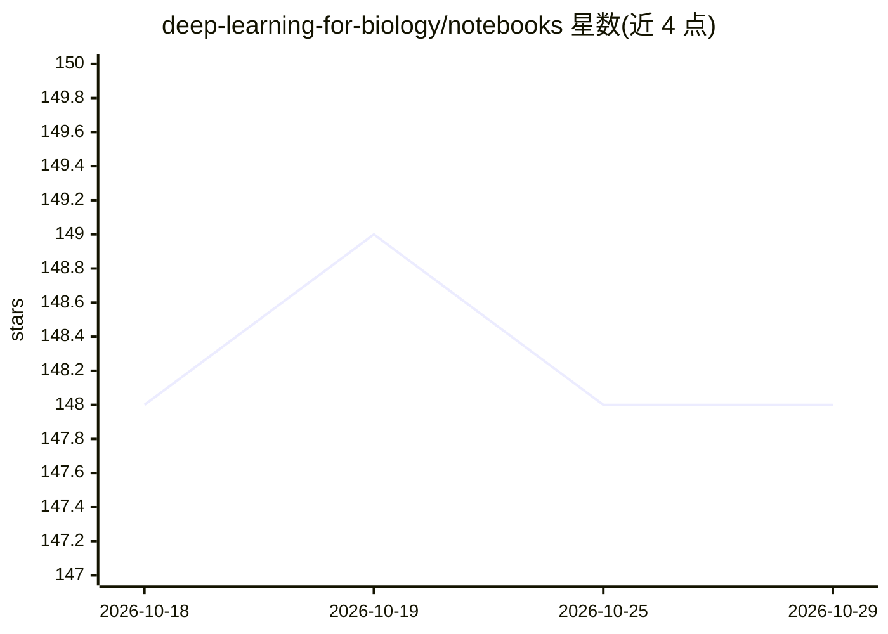

# deep-learning-for-biology/notebooks

⭐ 148 · Jupyter Notebook · 推送 2026-03-19 · [GitHub](https://github.com/deep-learning-for-biology/notebooks) · [官网](https://deep-learning-for-biology.com) · 组织维护

**《Deep Learning for Biology》配套可执行代码笔记本（第2-6章）**

O'Reilly 图书《Deep Learning for Biology》的伴随仓库，提供第 2-6 章五个项目章节的可执行 Jupyter 笔记本，内容覆盖蛋白质语言模型、DNA 序列学习、药物相互作用的图方法、皮肤癌医学图像检测与细胞内空间组织模式分析。笔记本仅含代码块，正文需查阅原书。面向学生、从业者与研究者，可直接上传到 Google Colab 并选择 GPU 后端运行；仓库内含 Apache 2.0 许可的 dlfb 库。更多受控环境的运行说明待补充。

## 筛选速览

| 维度 | 判定 | 备注 |
|---|---|---|
| AI 角色 | `ai-knowledge` | 知识聚合/清单类 |
| 许可风险 | `none` | — |
| 部署形态 | `None` |  |
| 模型依赖 | — | README 未给出锁定关系 |
| 硬件要求 | — | 无带数字的原话,不猜 |
| 安装摩擦 | `low` | 无编译、无系统依赖或容器化 |
| 成熟度 | `idea` | |

## 能力要点

- 覆盖五个项目章节的可执行笔记本（蛋白质/DNA/图/医学图像/细胞空间）
- 支持在 Google Colab 上选择 GPU 后端直接运行
- 含 dlfb 库，代码以 Apache 2.0 许可发布

## 适用场景

- 跟随图书章节动手实践深度学习生物学方法
- 将自己的生物学问题套用书中代码做实验
- 在 Colab 上无需本地配置环境即可复现章节代码

## 场景标签

`教程课程` · 领域:学习与行业

## 证据(README 行号)

> L9: This repo contains **Executable notebooks** for the five main project chapters of the book:
> L20: You can run the notebooks directly on **Google Colab** and select a GPU backend (usage limits apply). Simply visit 

## 星数曲线

2026-10-18 148 → 2026-10-29 148（+0）

---
*卡片 v1 · prompt 1.4 · 生成 2026-10-22 · 置信度 high · 依据 README sha `fd38b0d9ee14` · [字段定义](../../DATASET.md)*
