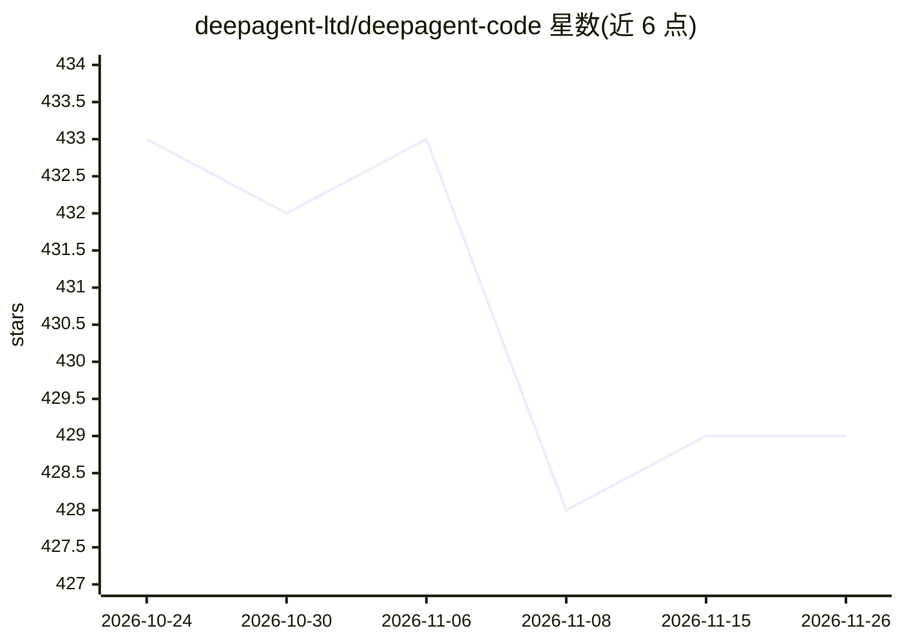

# deepagent-ltd/deepagent-code

⭐ 429 · TypeScript · NOASSERTION · 推送 2026-11-05 · [GitHub](https://github.com/deepagent-ltd/deepagent-code) · [官网](https://ai.deepagent.ltd/) · 组织维护 · 中文 README

**面向开发者的 AI 编码工作区：持久记忆+长任务执行**

DeepAgent Code 结合桌面编码工作区与终端 agent，共享同一执行核心：持久化会话与可编辑目标计划、可检视的项目记忆（带来源与准入控制）、可委派子代理的隔离 worktree 协作、托管浏览器操作，以及通过公共 IM 的 /dac 命令远程驱动本地 agent。GUI 与 TUI 共享核心，支持配置多个 provider、Skills、领域包与 MCP。源码针对 2.0.5 版本，桌面端提供安装包，源码构建需固定版本的 Bun。IM 功能需单独绑定设备的授权。

## 筛选速览

| 维度 | 判定 | 备注 |
|---|---|---|
| AI 角色 | `ai-native` | 本体是模型或模型工具 |
| 许可风险 | `none` | NOASSERTION |
| 部署形态 | `None` |  |
| 模型依赖 | — | README 未给出锁定关系 |
| 硬件要求 | — | 无带数字的原话,不猜 |
| 安装摩擦 | `low` | 无编译、无系统依赖或容器化 |
| 成熟度 | — | 结构信号不足 |

## 能力要点

- 持久会话：输入先落盘再调度，支持中断后区分已记录与需恢复的操作
- 可检视的项目记忆：事实/决策/技能带类型、范围与来源引用
- 子代理委派独立任务，写权限协作使用隔离 worktree 与评审边界
- 公共 IM /dac 命令在本地执行，附件上限 10 MiB

## 适用场景

- 跨多轮、多文件的长任务保持上下文与计划
- 把讨论中的任务通过 IM 指派给本地 agent 并取回结果
- 委派子代理并行处理独立的调研/实现/评审任务

## 场景标签

`编码 Agent` · 领域:编码与开发

## 证据(README 行号)

> L12: **DeepAgent Code (DAC)** combines a desktop coding workspace and a terminal agent with a shared execution core. It 
> L63: DAC combines file editing, terminal commands, LSP-backed code navigation, a managed browser, and project knowledge.

## 星数曲线

2026-10-24 433 → 2026-11-26 429（-4）

---
*卡片 v1 · prompt 1.4 · 生成 2026-11-25 · 置信度 high · 依据 README sha `cff18de343a9` · [字段定义](../../DATASET.md)*
