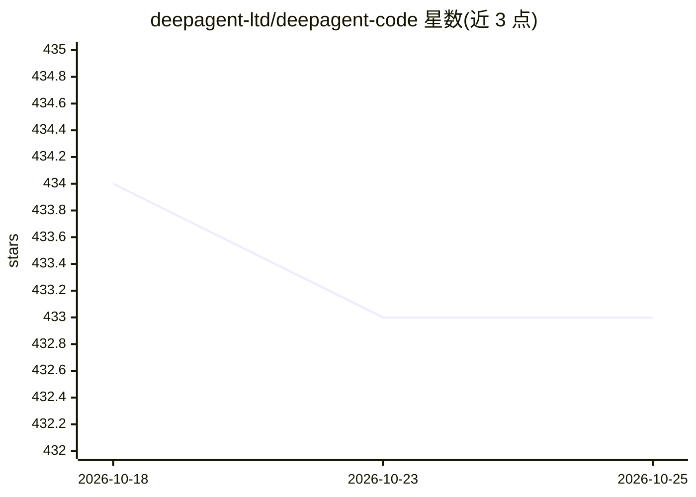

# deepagent-ltd/deepagent-code

⭐ 433 · TypeScript · NOASSERTION · 推送 2026-10-24 · [GitHub](https://github.com/deepagent-ltd/deepagent-code) · [官网](https://ai.deepagent.ltd/) · 组织维护 · 中文 README

**带持久记忆与 IM 接入的 AI 编程工作区**

结合桌面编程工作区与终端 agent，共享执行核心：持久会话、可编辑计划、可检视的项目记忆、子代理委派与隔离 worktree、桌面托管浏览器，以及通过 /dac 命令从 IM 调用本地 agent（最终答案回到会话）。文件编辑、终端命令、LSP 导航、Skills、domain packs 与 MCP 扩展构成工具层。面向需要跨多轮、多文件长期任务的开发者；需连接模型 provider，IM 激活为单独购买（1 credit）。以 AGPL-3.0-or-later 开源，提供 GitHub Releases 安装包或 Bun 1.4.2 从源码构建。

## 筛选速览

| 维度 | 判定 | 备注 |
|---|---|---|
| AI 角色 | `ai-ecosystem` | LLM/agent 周边工具 |
| 许可风险 | `none` | NOASSERTION |
| 部署形态 | `None` |  |
| 模型依赖 | — | README 未给出锁定关系 |
| 硬件要求 | — | 无带数字的原话,不猜 |
| 安装摩擦 | `low` | 无编译、无系统依赖或容器化 |
| 成熟度 | — | 结构信号不足 |

## 能力要点

- 持久会话、可编辑目标与计划、执行中实时引导
- 可检视的项目记忆，带来源与进入上下文的受控准入
- 子代理委派、隔离 worktree 与审查边界
- IM 中 /dac 命令调用本地 agent，答案返回原会话

## 适用场景

- 跨多文件、多轮的长时编程任务管理
- 在 IM 讨论中直接把工作委派给本地 agent 并跟进
- 保留并复用项目决策与执行证据，避免重复交代上下文

## 场景标签

`编码 Agent` `Agent 记忆` · 领域:Agent 开发

## 证据(README 行号)

> L12: **DeepAgent Code (DAC)** combines a desktop coding workspace and a terminal agent with a shared execution core. It 
> L61: DAC combines file editing, terminal commands, LSP-backed code navigation, a managed browser, and project knowledge.

## 星数曲线

2026-10-18 434 → 2026-10-25 433（-1）

---
*卡片 v1 · prompt 1.4 · 生成 2026-10-21 · 置信度 high · 依据 README sha `ea0699b5613a` · [字段定义](../../DATASET.md)*
