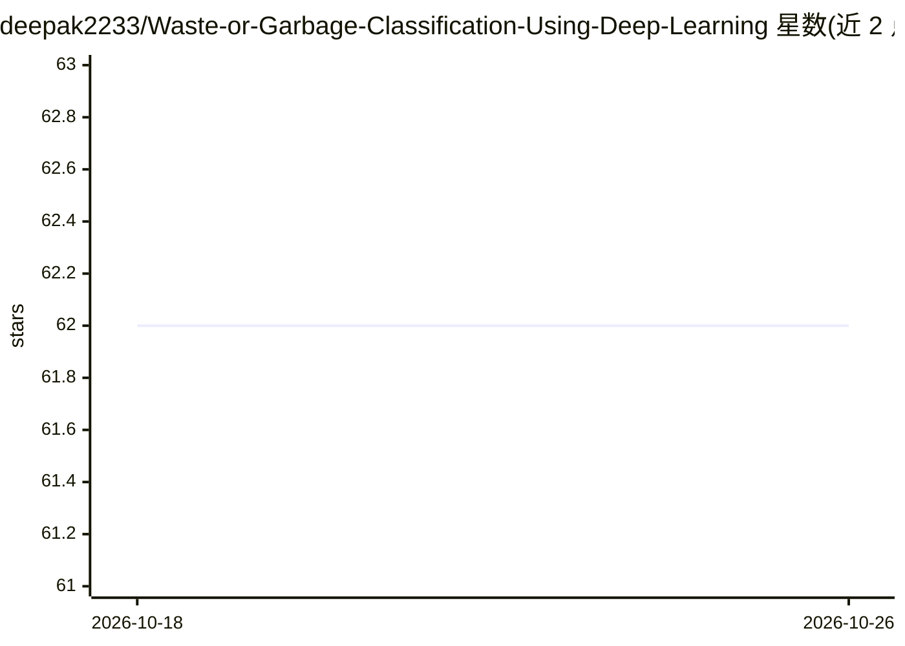

# deepak2233/Waste-or-Garbage-Classification-Using-Deep-Learning

⭐ 62 · Jupyter Notebook · MIT · 推送 2026-09-21 · [GitHub](https://github.com/deepak2233/Waste-or-Garbage-Classification-Using-Deep-Learning) · [官网](https://garbageclassification-eight.vercel.app) · 个人维护

**垃圾图像分类工具包：识别照片中废弃物类别并可服务化部署**

基于 TensorFlow/Keras 的废弃物图像分类 Python 包，从 2019 年的笔记本重构而来。两阶段机制：先用无需训练的区域提议器（grid/content）在场景图中切分候选区域，再用分类器将每个区域归入 12 类（电池/玻璃/纸板/塑料等）；分类器也可独立用于单物体照片。支持 7 种骨干网络（EfficientNet/MobileNetV2/ResNet50V2/VGG16/SwinConvNeXt 等），两阶段微调训练、逆类频率加权损失、macro-F1 监控。提供 CLI（wasteclf train/predict/scene/serve/export）、HTTP 服务、Docker 与 ONNX/TFLite 导出（含 serverless 部署）。训练数据为 garbage12（15,515 张，需 Kaggle 凭据）与 TrashNet（2,527 张，公开）。Swin 分支无公开预训练权重，从随机初始化训练，作者说明达不到论文数字。

## 筛选速览

| 维度 | 判定 | 备注 |
|---|---|---|
| AI 角色 | `ai-native` | 本体是模型或模型工具 |
| 许可风险 | `permissive` | MIT |
| 部署形态 | `self-host` | docker 或自建部署 |
| 模型依赖 | — | README 未给出锁定关系 |
| 硬件要求 | — | 无带数字的原话,不猜 |
| 安装摩擦 | `low` | 无编译、无系统依赖或容器化 |
| 成熟度 | — | 结构信号不足 |

## 能力要点

- 场景级两阶段机制：免训练区域提议器 + 12 类闭集分类器
- 7 种骨干网络可选，含 SwinConvNeXt 双分支实现
- ONNX 导出后运行时约 180 MB，支持 serverless 部署
- 每次训练留完整 run 目录（config/labels），predict 直接读取

## 适用场景

- 对垃圾场照片做整场景的废弃物组成分析
- 训练并部署自己的废弃物分类模型为 HTTP 服务
- 在手机或 serverless 环境运行导出后的轻量模型

## 场景标签

`目标检测` · 领域:感知与多模态

## 证据(README 行号)

> L3: Finds waste in a photograph of a dump area and sorts each item into twelve
> L6: Two stages. A segmenter proposes regions in the scene; a classifier names each
> L7: one. The classifier also works standalone on single-object photos, which is

## 星数曲线

2026-10-18 62 → 2026-10-26 62（+0）

---
*卡片 v1 · prompt 1.4 · 生成 2026-10-24 · 置信度 high · 依据 README sha `aabdbe0cdade` · [字段定义](../../DATASET.md)*
