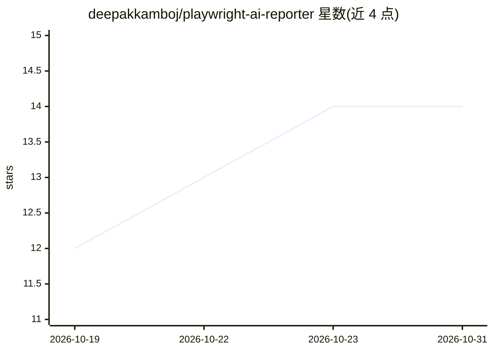

# deepakkamboj/playwright-ai-reporter

⭐ 14 · TypeScript · MIT · 推送 2026-10-17 · [GitHub](https://github.com/deepakkamboj/playwright-ai-reporter) · [官网](https://deepakkamboj.github.io/playwright-ai-reporter/) · 个人维护

**给 Playwright 用户的 AI 测试报告器：分析失败并建议修复**

实现 Playwright Reporter 接口的测试报告工具，面向使用 Playwright 的开发团队：输出彩色控制台统计、自包含 HTML 健康报告、慢测试排名与历史趋势；失败发生时可调用多家 AI 提供商（OpenAI/Azure/Anthropic/Gemini/Mistral/Copilot）生成修复建议与错误分类，并在 GitHub Issues、Jira、Azure DevOps 上建 bug，可选生成含 AI 修复的草稿 PR。采用 provider 注册架构，支持 SQLite/MySQL 存储与统一密钥脱敏。需 Node.js 22+ 与 Playwright 1.51+。

## 筛选速览

| 维度 | 判定 | 备注 |
|---|---|---|
| AI 角色 | `ai-enhanced` | 去掉 AI 部分产品仍成立 |
| 许可风险 | `permissive` | MIT |
| 部署形态 | `library` | 以包/库形式分发 |
| 模型依赖 | locked-api |  |
| 硬件要求 | — | 无带数字的原话,不猜 |
| 安装摩擦 | `low` | 无编译、无系统依赖或容器化 |
| 成熟度 | — | 结构信号不足 |

## 能力要点

- 多 AI 提供商失败分析与修复建议（Copilot 可复用 GITHUB_TOKEN）
- 自动建 bug（GitHub/Jira/Azure DevOps）与自动生成修复 PR（草稿）
- 自包含单文件 HTML 健康报告，无 CDN/服务器依赖
- 分片合并、init/doctor 引导 CLI 与统一密钥脱敏边界

## 适用场景

- CI/CD 流水线中自动分析测试失败并生成修复建议
- 把失败测试自动登记为 bug 并附带证据与 AI 分析
- 跨分片/矩阵合并测试结果并追踪 flaky 与历史趋势

## 场景标签

`编码 Agent` · 领域:编码与开发

## 证据(README 行号)

> L14: **Playwright AI Reporter** is an enterprise-grade, production-ready test reporter that combines artificial intellig
> L70: - 🧠 **Multi-AI Provider Support**: GitHub Copilot, Azure OpenAI, OpenAI, Anthropic (Claude), Google AI (Gemini), Mi
> L139: |**Reporter**|Main entry point implementing Playwright's Reporter interface|

## 星数曲线

2026-10-19 12 → 2026-10-31 14（+2）

---
*卡片 v1 · prompt 1.4 · 生成 2026-10-31 · 置信度 high · 依据 README sha `f3ee58a1f118` · [字段定义](../../DATASET.md)*
