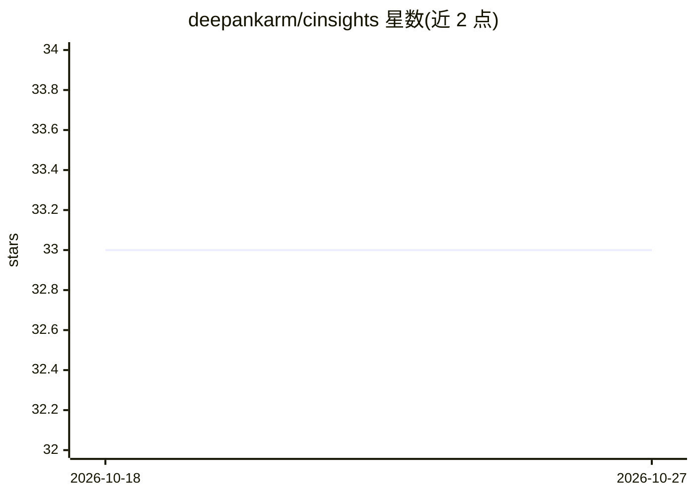

# deepankarm/cinsights

⭐ 33 · Python · Apache-2.0 · 推送 2026-04-28 · [GitHub](https://github.com/deepankarm/cinsights) · 个人维护

**团队级 AI 编码代理使用洞察与摩擦分析工具**

面向工程团队的 AI 编码代理分析平台：读取 Claude Code 与 Codex 的本地会话文件（~/.claude、~/.codex），或接入 Entire.io 与 Arize Phoenix，跨会话、跨代理、跨团队聚合分析。输出项目级摘要（有效做法、阻碍点、改进建议）、有据可查的摩擦分析（含可直接粘贴的 CLAUDE.md 规则建议）与开发者画像（工作领域、交互风格、工具偏好）。pip 安装后启动本地 Web 界面（localhost:8100），支持自托管。

## 筛选速览

| 维度 | 判定 | 备注 |
|---|---|---|
| AI 角色 | `ai-ecosystem` | LLM/agent 周边工具 |
| 许可风险 | `permissive` | Apache-2.0 |
| 部署形态 | `library` | 以包/库形式分发 |
| 模型依赖 | — | README 未给出锁定关系 |
| 硬件要求 | — | 无带数字的原话,不猜 |
| 安装摩擦 | `low` | 无编译、无系统依赖或容器化 |
| 成熟度 | — | 结构信号不足 |

## 能力要点

- 读取 ~/.claude 与 ~/.codex 会话文件，本地零依赖试用
- 跨会话聚合的项目摘要：有效做法、阻碍点、快速改进项
- 摩擦分析关联具体会话并给出 CLAUDE.md 规则建议
- 支持 Local / Entire.io / Phoenix 三种数据源

## 适用场景

- 团队想知道 AI 编码代理在哪些项目、哪些环节用得好或卡壳
- 从真实摩擦数据生成可落地的 CLAUDE.md 规则与改进建议
- 了解不同开发者使用编码代理的方式与质量差异

## 场景标签

`LLM 可观测性` · 领域:评测与运维

## 证据(README 行号)

> L9: cinsights helps engineering teams track, understand, and improve how their developers work with AI coding agents. No
> L42: |Phoenix|Arize Phoenix traces|Centralized team observability.|
> L52: - Self-hosting - run cinsights on your infrastructure

## 星数曲线

2026-10-18 33 → 2026-10-27 33（+0）

---
*卡片 v1 · prompt 1.4 · 生成 2026-10-26 · 置信度 high · 依据 README sha `9dba14a1789d` · [字段定义](../../DATASET.md)*
