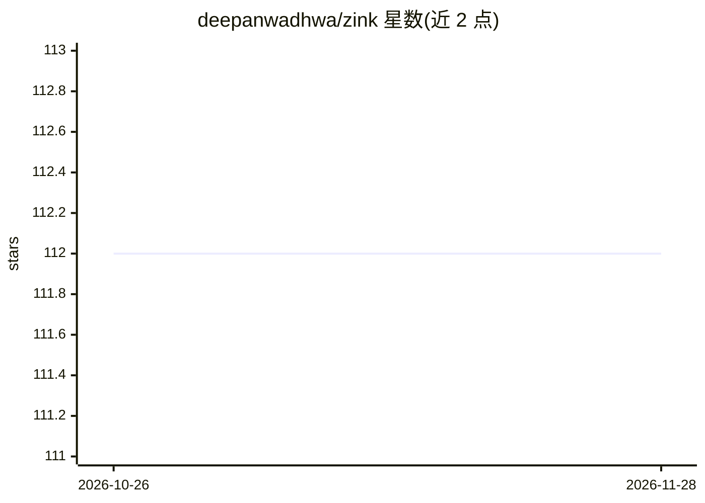

# deepanwadhwa/zink

⭐ 112 · Python · Apache-2.0 · 推送 2026-11-20 · [GitHub](https://github.com/deepanwadhwa/zink) · 个人维护

**Python 库：用零样本 NER 模型对文本中的 PII 实体做脱敏**

ZINK 提供 Python 包与 Docker REST API，用零样本 NER 模型（GLiNER 架构的 NuNerZero）识别非结构化文本中的准标识符并执行 redact 或 replace 操作：替换值可由 Faker 生成、用户自定义字典提供，支持跨调用持久化的编号占位符映射（~/.zink/mapping.json，0600 权限），以及 @zink.shield 装饰器在函数调用前后脱敏与还原参数。配套发布 QIB 基准（1750 例、35 类准标识符）。首次推理需从 Hugging Face 下载约 2 GB 模型文件，模型可能漏检，README 提醒人工复查输出。

## 筛选速览

| 维度 | 判定 | 备注 |
|---|---|---|
| AI 角色 | `ai-native` | 本体是模型或模型工具 |
| 许可风险 | `permissive` | Apache-2.0 |
| 部署形态 | `self-host` | docker 或自建部署 |
| 模型依赖 | — | README 未给出锁定关系 |
| 硬件要求 | — | 无带数字的原话,不猜 |
| 安装摩擦 | `low` | 无编译、无系统依赖或容器化 |
| 成熟度 | — | 结构信号不足 |

## 能力要点

- 零样本 NER 识别任意标签实体并支持 redact/replace 两种脱敏方式
- Faker 合成替换与自定义替换字典（BYOD）
- @zink.shield 装饰器在调用外部 API 前脱敏参数、返回后还原
- Docker 镜像预装模型并暴露 /redact REST API

## 适用场景

- 把含个人信息的文本送入 LLM 前先做脱敏
- 对非结构化文本批量替换敏感实体为合成数据
- 按自定义标签字典做一致性脱敏映射
- 以 REST API 形式在容器中提供脱敏服务

## 场景标签

 · 领域:隐私保护/NLP

## 证据(README 行号)

> L13: ZINK is a Python package designed for zero-shot anonymization of entities within unstructured text data. It allows 
> L224: ### GLiNER

## 星数曲线

2026-10-26 112 → 2026-11-28 112（+0）

---
*卡片 v1 · prompt 1.4 · 生成 2026-11-28 · 置信度 high · 依据 README sha `d3a42ba34bc9` · [字段定义](../../DATASET.md)*
