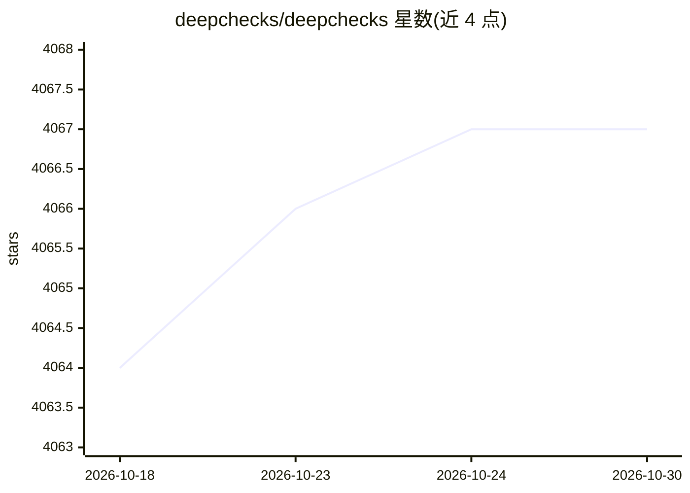

# deepchecks/deepchecks

⭐ 4,067 · Python · NOASSERTION · 推送 2025-12-28 · [GitHub](https://github.com/deepchecks/deepchecks) · [官网](https://docs.deepchecks.com/stable) · 组织维护

**ML 模型与数据持续验证测试库：测试、CI 与生产监控**

面向数据科学与 MLOPS 团队的开源 Python 库（AGPL 3.0），核心是针对 Tabular、NLP、CV 数据与模型的大量内置 Check 与可组合 Suite，用于检测性能薄弱片段、数据漂移、泄漏、标签冲突等问题；结果可存 HTML、在 Jupyter 展示或以 Python/JSON 输出，支持添加 pass/fail 条件并接入 CI/CD。另有生产监控与测试管理组件（开源+托管），商业版许可代码位于 monitoring 仓库 ee 目录，自托管启用需商业许可；开源监控部署每个实例仅支持单模型，Windows 本地部署为 WIP。

## 筛选速览

| 维度 | 判定 | 备注 |
|---|---|---|
| AI 角色 | `ai-ecosystem` | LLM/agent 周边工具 |
| 许可风险 | `none` | NOASSERTION |
| 部署形态 | `library` | 以包/库形式分发 |
| 模型依赖 | — | README 未给出锁定关系 |
| 硬件要求 | — | 无带数字的原话,不猜 |
| 安装摩擦 | `low` | 无编译、无系统依赖或容器化 |
| 成熟度 | — | 结构信号不足 |

## 能力要点

- 覆盖 Tabular/NLP/Vision 的内置 Check 与可自定义 Suite 框架
- 检查性能薄弱片段、数据漂移、泄漏、标签冲突等问题
- 结果可输出 HTML 报告、Jupyter 展示或 Python/JSON 处理
- 可加 pass/fail/warning 条件并接入 CI/CD 与生产监控

## 适用场景

- 研究阶段评估模型是否达到上线标准
- CI/CD 流程中自动验证数据与模型质量
- 生产环境持续监控模型行为与数据漂移

## 场景标签

`MLOps` · 领域:训练与推理

## 证据(README 行号)

> L34: - **Deepchecks Testing**
> L133: At its core, deepchecks includes a wide variety of built-in Checks,
> L139: about your model's production-readiness, and for monitoring it over time in production.

## 星数曲线

2026-10-18 4,064 → 2026-10-30 4,067（+3）

---
*卡片 v1 · prompt 1.4 · 生成 2026-10-20 · 置信度 high · 依据 README sha `41666f6518e3` · [字段定义](../../DATASET.md)*
