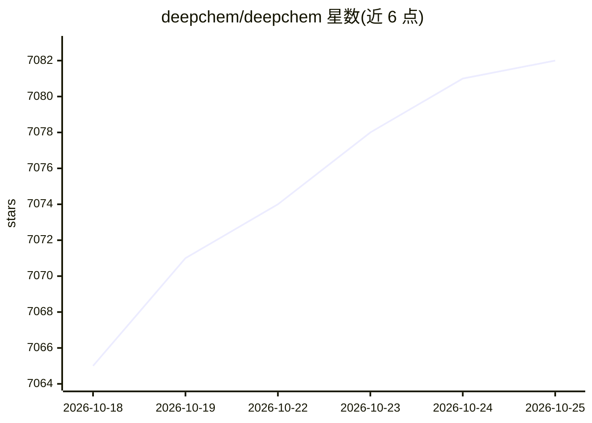

# deepchem/deepchem

⭐ 7,082 · Python · MIT · 推送 2026-08-20 · [GitHub](https://github.com/deepchem/deepchem) · [官网](https://deepchem.io/) · 组织维护

**面向药物发现、材料、量子化学与生物学的深度学习开源库**

Python 科学计算库，为药物发现、材料科学、量子化学与生物学领域提供深度学习工具链。核心依赖 joblib、NumPy、pandas、scikit-learn、SciPy 与 rdkit；支持 TensorFlow、PyTorch、Jax 三种深度学习框架的模型，各需单独的 pip extras 安装，GPU 场景需先装 CUDA 及对应框架。通过 pip/conda 安装稳定版，另提供 nightly 版本、Docker 镜像与源码安装途径，配套 Colab 教程序列。

## 筛选速览

| 维度 | 判定 | 备注 |
|---|---|---|
| AI 角色 | `ai-native` | 本体是模型或模型工具 |
| 许可风险 | `permissive` | MIT |
| 部署形态 | `self-host` | docker 或自建部署 |
| 模型依赖 | — | README 未给出锁定关系 |
| 硬件要求 | — | 无带数字的原话,不猜 |
| 安装摩擦 | `low` | 无编译、无系统依赖或容器化 |
| 成熟度 | — | 结构信号不足 |

## 能力要点

- 覆盖药物发现、材料科学、量子化学、生物学四个领域
- 同时支持 TensorFlow / PyTorch / Jax 后端（各自独立 extras）
- 提供 pip/conda/nightly/Docker/源码多种安装途径
- 维护按学习顺序编排的 Colab 教程集与示例

## 适用场景

- 在分子机器学习与计算生物学任务上构建模型
- 从现有示例与教程出发改造应用到自己的问题
- 在 GPU 环境下用 TensorFlow/PyTorch/Jax 训练科学计算模型

## 场景标签

 · 领域:计算化学/生物/AI4Science

## 证据(README 行号)

> L13: DeepChem aims to provide a high quality open-source toolchain
> L25: DeepChem currently supports Python 3.7 through 3.10 and requires these packages on any condition.

## 星数曲线

2026-10-18 7,065 → 2026-10-25 7,082（+17）

---
*卡片 v1 · prompt 1.4 · 生成 2026-10-20 · 置信度 high · 依据 README sha `6f64ddf2ffc3` · [字段定义](../../DATASET.md)*
