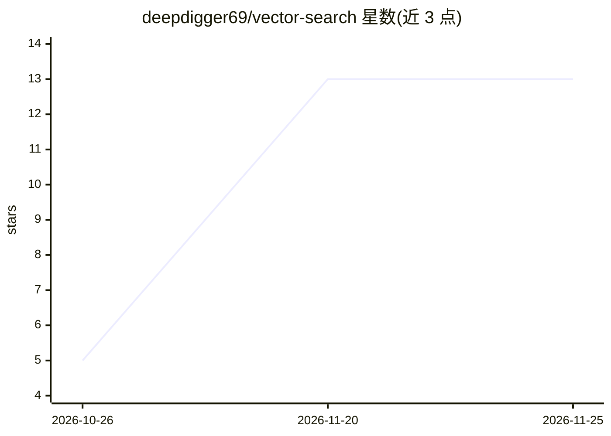

# deepdigger69/vector-search

⭐ 13 · Go · MIT · 推送 2026-10-26 · [GitHub](https://github.com/deepdigger69/vector-search) · 个人维护

**Go 编写的向量数据库：对数时间相似向量检索**

基于 tobias-mayer/vector-db 项目学习并扩展而来的向量数据库，用于在对数时间内检索相似向量，基于余弦相似度返回最近邻结果。仓库以 Go 语言实现，提供示例程序（examples/helloworld）演示检索用法，并通过 Makefile 提供 bootstrap（安装构建依赖）与 build（构建 golang 二进制）等目标；README 含 codecov 徽章与目录，未给出部署架构、持久化或客户端 API 的说明。

## 筛选速览

| 维度 | 判定 | 备注 |
|---|---|---|
| AI 角色 | `ai-native` | 本体是模型或模型工具 |
| 许可风险 | `permissive` | MIT |
| 部署形态 | `None` |  |
| 模型依赖 | — | README 未给出锁定关系 |
| 硬件要求 | — | 无带数字的原话,不猜 |
| 安装摩擦 | `low` | 无编译、无系统依赖或容器化 |
| 成熟度 | — | 结构信号不足 |

## 能力要点

- 对数时间的相似向量检索
- 余弦相似度最近邻输出
- Makefile 提供 bootstrap/build 等构建目标
- 提供可运行的 Go 示例程序

## 适用场景

- 需要相似向量检索的本地开发与实验
- 学习向量数据库的实现与扩展方式

## 场景标签

`向量数据库` · 领域:知识与检索

## 证据(README 行号)

> L5: A simple vector database that can be used to search for similar vectors in logarithmic time.
> L19: $> go run examples/helloworld/helloworld.go

## 星数曲线

2026-10-26 5 → 2026-11-25 13（+8）

---
*卡片 v1 · prompt 1.4 · 生成 2026-11-20 · 置信度 mid · 依据 README sha `fb9afa2df07f` · [字段定义](../../DATASET.md)*
