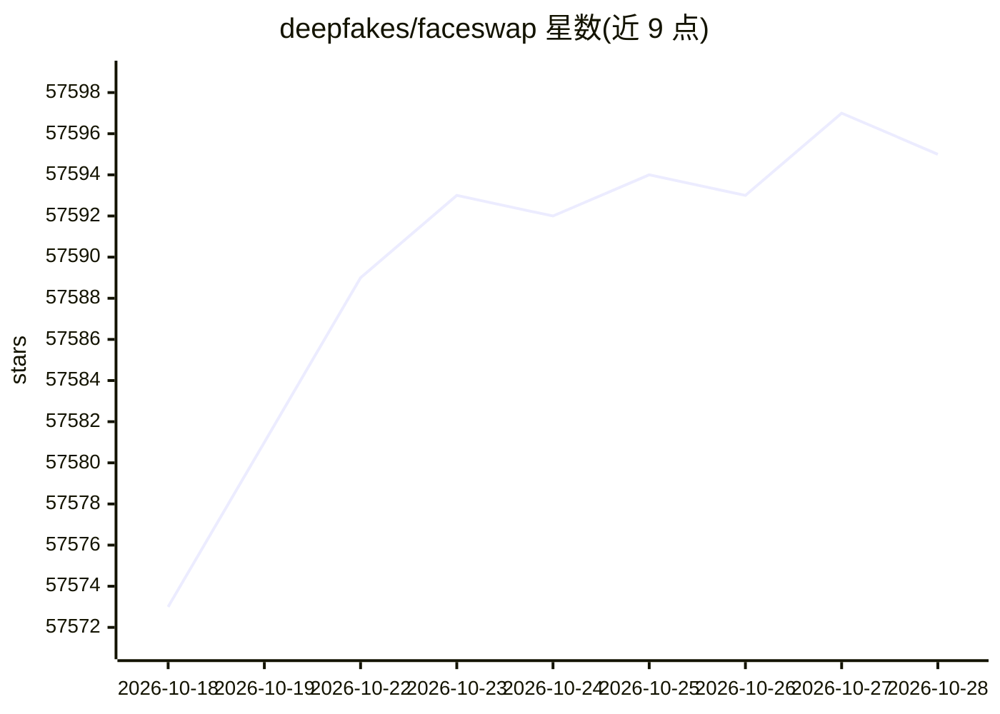

# deepfakes/faceswap

⭐ 57,594 · Python · GPL-3.0 · 推送 2026-08-05 · [GitHub](https://github.com/deepfakes/faceswap) · [官网](https://www.faceswap.dev) · 组织维护

**给研究/创作者用深度学习换脸图片与视频的工具**

FaceSwap 是一个用深度学习识别并替换图片和视频中人脸的 Python 程序，工作流分为提取人脸、训练模型、应用转换三步，均通过 faceswap.py 命令行调用，另提供 GUI 入口和基于 ffmpeg 的视频转换工具。可运行于 Windows、Linux 和 macOS，README 建议使用支持 CUDA 的现代 GPU 以获得更好性能，AMD GPU 在 Linux 上可经 ROCm 支持。项目明确列出伦理约束，禁止用于未经同意或不当内容的制作，支持主要通过 Discord 和论坛提供。

## 筛选速览

| 维度 | 判定 | 备注 |
|---|---|---|
| AI 角色 | `ai-native` | 本体是模型或模型工具 |
| 许可风险 | `viral` | GPL-3.0 |
| 部署形态 | `None` |  |
| 模型依赖 | — | README 未给出锁定关系 |
| 硬件要求 | — | 无带数字的原话,不猜 |
| 安装摩擦 | `medium` | 含编译或系统依赖之一 |
| 成熟度 | — | 结构信号不足 |

## 动量与使用信号

- 维护:`active` — 距上次 push 73.8 天,年发版 2,81 位贡献者
- 涨星:近 1 天 **+3**(自 20261016 起算)
- 下载:GitHub Release 附件 累计 134,368(5 个 release)

## 能力要点

- extract/train/convert 三段式换脸工作流与 GUI 入口
- 支持 Windows/Linux/macOS 多平台
- AMD GPU 可通过 ROCm 支持（Linux）
- 附视频格式转换工具（effmpeg/ffmpeg）

## 适用场景

- 将照片或视频中的人脸替换为模型学到的另一张脸
- 动手实验和学习深度学习人脸技术
- 影视或社会评论类的合规换脸制作

## 场景标签

`图像视频处理` · 领域:感知与多模态

## 证据(README 行号)

> L6:  FaceSwap is a tool that utilizes deep learning to recognize and swap faces in pictures and videos.
> L45: FaceSwap is a Python program that will run on multiple Operating Systems including Windows, Linux, and MacOS.
> L47: See INSTALL.md for full installation instructions. You will need a modern GPU with CUDA support for best performanc

## 星数曲线

2026-10-18 57,573 → 2026-10-28 57,595（+22）

---
*卡片 v1 · prompt 1.4 · 生成 2026-10-18 · 置信度 high · 依据 README sha `c3552d40a40f` · [字段定义](../../DATASET.md)*
