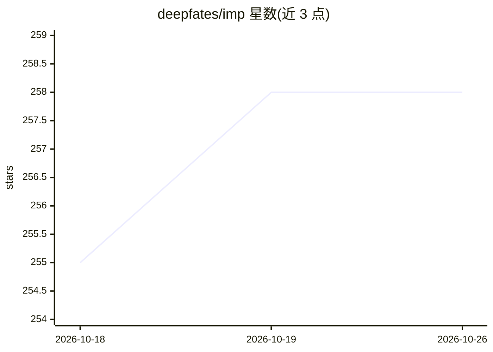

# deepfates/imp

⭐ 258 · Elixir · MIT · 推送 2026-10-23 · [GitHub](https://github.com/deepfates/imp) · [官网](https://hex.pm/packages/imp) · 个人维护

**Elixir 版 DSPy：声明式可自优化的 LLM 程序框架**

DSPy 在 BEAM 上的移植：以签名声明模型调用的输入输出，提供 chain_of_thought、ReAct、agent 循环与检索等模块，以及 GEPA、MIPROv2、SIMBA、BootstrapFewShot 等优化器，用标注数据与度量自动改写指令和示例。agent 以 OTP 进程运行，可监督、可授权工具调用、可设截止时间；另支持 MCP 工具导入与 ACP 客户端对外提供 agent。模型接入经由 ReqLLM。需 Elixir 1.19+ 与 C/C++ 编译器，0.14 阶段自述 API 可能变动。

## 筛选速览

| 维度 | 判定 | 备注 |
|---|---|---|
| AI 角色 | `ai-ecosystem` | LLM/agent 周边工具 |
| 许可风险 | `permissive` | MIT |
| 部署形态 | `None` |  |
| 模型依赖 | — | README 未给出锁定关系 |
| 硬件要求 | — | 无带数字的原话,不猜 |
| 安装摩擦 | `low` | 无编译、无系统依赖或容器化 |
| 成熟度 | `idea` | |

## 能力要点

- 签名声明式模型调用，自动构建 prompt 并按类型校验返回
- 多种优化器（GEPA/MIPROv2/SIMBA/BootstrapFewShot 等）自动改进程序
- agent 以 OTP 受监督进程运行，支持工具调用授权与事件流观察
- MCP 工具导入与 ACP 协议对外服务

## 适用场景

- 在 Elixir 应用中构建可测量、可优化的 LLM 程序
- 用标注数据自动改写 agent 指令与示例以提升表现
- 运行长时 agent 并对其工具调用做授权与监督

## 场景标签

`Agent 框架` `提示工程` · 领域:Agent 开发

## 证据(README 行号)

> L8: Imp is a full port of DSPy to the BEAM. You describe what
> L11: signatures, modules, optimizers, agent loops and retrieval, running with the
> L75: `Imp.call/2` runs a program in your process. `Imp.start_run/3` runs it as its

## 星数曲线

2026-10-18 255 → 2026-10-26 258（+3）

---
*卡片 v1 · prompt 1.4 · 生成 2026-10-22 · 置信度 high · 依据 README sha `fbf5954ae2fa` · [字段定义](../../DATASET.md)*
