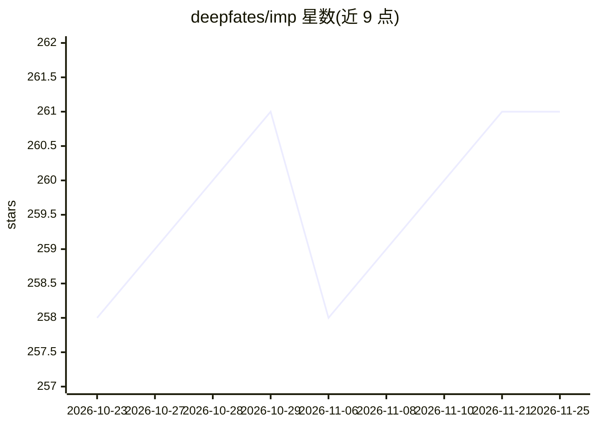

# deepfates/imp

⭐ 261 · Elixir · MIT · 推送 2026-11-01 · [GitHub](https://github.com/deepfates/imp) · [官网](https://hex.pm/packages/imp) · 个人维护

**Elixir 版 DSPy 移植：声明式可优化的 LLM 程序框架**

Imp 将 DSPy 完整移植到 BEAM，供 Elixir 开发者构建语言模型程序。核心机制：用签名声明每个 LLM 步骤的输入输出，框架据此生成提示词并校验类型化返回；提供 chain_of_thought、react、agent 循环与检索；GEPA、MIPROv2、SIMBA、GRPO 等优化器基于标注样本对程序评分并重写指令，结果可存为 JSON 与 diff。运行层面复用 OTP：agent 是受监督的进程，可观察、停止并限制工具调用，支持 MCP 工具导入与 ACP 对接 Zed。需 Elixir 1.19+ 与 C/C++ 编译器，0.14 版为实验性、API 可能变动。

## 筛选速览

| 维度 | 判定 | 备注 |
|---|---|---|
| AI 角色 | `ai-ecosystem` | LLM/agent 周边工具 |
| 许可风险 | `permissive` | MIT |
| 部署形态 | `None` |  |
| 模型依赖 | — | README 未给出锁定关系 |
| 硬件要求 | — | 无带数字的原话,不猜 |
| 安装摩擦 | `low` | 无编译、无系统依赖或容器化 |
| 成熟度 | `idea` | |

## 能力要点

- 签名式声明 LLM 调用，自动生成提示词并做类型校验
- GEPA/MIPROv2/SIMBA/GRPO 等优化器基于样本评分与改写程序
- agent 以 OTP 监督进程运行，支持工具调用授权与截止时间
- MCP 工具导入与 ACP 服务（对接 Zed 等 ACP 客户端）

## 适用场景

- 在 Elixir/OTP 应用中以类型化方式接入 LLM 调用
- 用标注样本优化既有 LLM 程序的指令与示例
- 将 LLM agent 作为受监督进程纳入 OTP 应用生命周期
- 把 agent 程序通过 ACP 提供给 Zed 等编辑器客户端

## 场景标签

`提示工程` `Agent 框架` · 领域:Agent 开发

## 证据(README 行号)

> L8: Imp is a full port of DSPy to the BEAM. You describe what
> L11: signatures, modules, optimizers, agent loops and retrieval, running with the
> L121: Imp needs Elixir 1.19 or later and a C and C++ compiler, for the native code

## 星数曲线

2026-10-23 258 → 2026-11-25 261（+3）

---
*卡片 v1 · prompt 1.4 · 生成 2026-11-25 · 置信度 high · 依据 README sha `97920424479d` · [字段定义](../../DATASET.md)*
