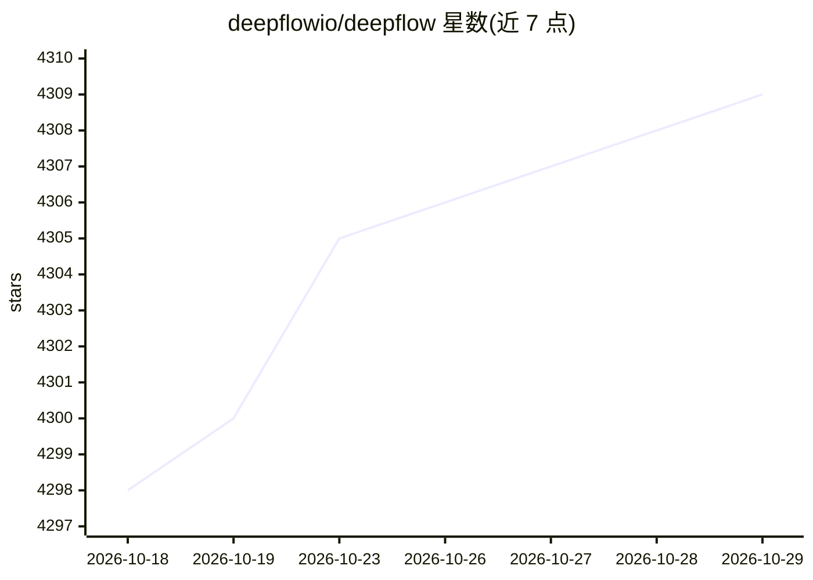

# deepflowio/deepflow

⭐ 4,309 · Go · Apache-2.0 · 推送 2026-10-26 · [GitHub](https://github.com/deepflowio/deepflow) · [官网](https://deepflow.io) · 组织维护 · 中文 README

**给 DevOps/SRE 的 eBPF 零侵扰全栈可观测性平台（指标/追踪/剖析）**

DeepFlow 是开源可观测性平台，面向云原生与 AI 应用的 DevOps/SRE 团队。基于 eBPF 实现零代码（Zero Code）采集指标、分布式追踪、请求日志与函数剖析（OnCPU/OffCPU/GPU/内存/网络火焰图，覆盖 CUDA 函数），配合 SmartEncoding 注入预编码元数据标签做全栈关联。可作为 Prometheus、OpenTelemetry、SkyWalking、Pyroscope 的存储后端，提供 SQL/PromQL/OLTP API。架构为 Agent（K8s 节点/主机采集）+ Server（管理、标签注入、摄取与查询）。分 Community/Enterprise/Cloud 三个版本，社区版为企业版核心组件，可用 Docker 部署或从源码编译 deepflow-agent。

## 筛选速览

| 维度 | 判定 | 备注 |
|---|---|---|
| AI 角色 | `ai-ecosystem` | LLM/agent 周边工具 |
| 许可风险 | `permissive` | Apache-2.0 |
| 部署形态 | `self-host` | docker 或自建部署 |
| 模型依赖 | — | README 未给出锁定关系 |
| 硬件要求 | — | 无带数字的原话,不猜 |
| 安装摩擦 | `low` | 无编译、无系统依赖或容器化 |
| 成熟度 | — | 结构信号不足 |

## 能力要点

- eBPF 零代码采集：指标、分布式追踪、请求日志、函数剖析
- 持续剖析覆盖 OnCPU/OffCPU/GPU/内存/网络与 CUDA 函数火焰图，开销低于 1%
- SmartEncoding 元数据标签注入，宣称存储开销较 ClickHouse 方法降低 10x
- 可作为 Prometheus/OpenTelemetry/SkyWalking/Pyroscope 的存储后端，提供 SQL/PromQL/OLTP API

## 适用场景

- 微服务与 K8s 环境的零侵扰分布式追踪与性能瓶颈定位
- GPU/AI 应用训练与推理服务的函数级剖析
- 统一存储与关联现有 Prometheus/OpenTelemetry 可观测性数据

## 场景标签

 · 领域:可观测性/云原生基础设施

## 证据(README 行号)

> L16: The DeepFlow open-source project aims to provide deep observability for complex cloud-native and AI applications. D
> L22: - **Continuous Profiling** for **Any** Function: DeepFlow collects profiling data at a cost of below 1% with **Zero

## 星数曲线

2026-10-18 4,298 → 2026-10-29 4,309（+11）

---
*卡片 v1 · prompt 1.4 · 生成 2026-10-21 · 置信度 high · 依据 README sha `c993385fe343` · [字段定义](../../DATASET.md)*
