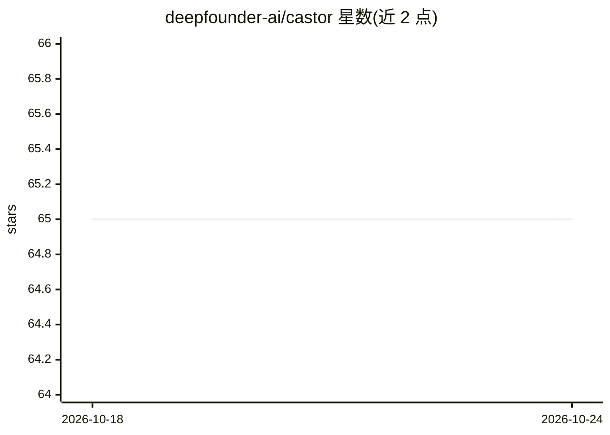

# deepfounder-ai/castor

⭐ 65 · Python · MIT · 推送 2026-08-01 · [GitHub](https://github.com/deepfounder-ai/castor) · [官网](https://qwe-qwe.deepfounder.ai/) · 组织维护

**自托管商业流程 AI agent：客服/自动化/知识检索/定时报告**

面向业务工作流的自托管 AI agent，可接入任意 OpenAI 兼容 LLM（Azure OpenAI、AWS Bedrock、OpenAI、Groq、OpenRouter、DeepSeek 或经 LM Studio/Ollama 的本地模型），数据留在自有基础设施。提供 web UI、终端与 Telegram 三种界面，内置工具搜索、三层语义记忆与知识图谱、50+ 格式知识摄取、Playwright 浏览器控制、USB/串口硬件访问（秤/扫码器/GPS/PLC）、cron 式定时任务、目标编排与 MCP 集成。以 Python 实现，pip/安装脚本部署于 Linux/macOS/Windows。

## 筛选速览

| 维度 | 判定 | 备注 |
|---|---|---|
| AI 角色 | `ai-native` | 本体是模型或模型工具 |
| 许可风险 | `permissive` | MIT |
| 部署形态 | `desktop` | 安装包/桌面程序 |
| 模型依赖 | local-ok | 支持本地模型 |
| 硬件要求 | `gpu-8g` | |
| 安装摩擦 | `low` | 无编译、无系统依赖或容器化 |
| 成熟度 | — | 结构信号不足 |

## 能力要点

- 任意 OpenAI 兼容 provider 可切换，支持 LM Studio/Ollama 本地模型
- 三层记忆系统（Qdrant 混合检索 + 知识图谱 + 每日合成）
- USB/串口访问秤、扫码器、GPS、标签打印机与 PLC（Modbus RTU）
- 定时任务、长时目标编排、MCP 工具服务器集成与按线程成本追踪

## 适用场景

- 在企业自有服务器上运行客服与内部自动化 agent
- 接入本地 Ollama 模型实现全内网知识检索与问答
- 定时生成报告并操控产线串口设备
- 通过 Telegram 远程使用 agent 处理业务任务

## 场景标签

`浏览器自动化` `工作流自动化` `聊天机器人` · 领域:效率与自动化

## 证据(README 行号)

> L25: A **business-oriented AI agent** built to drop into real workflows: customer ops, internal automation, knowledge re
> L27: **Bring your own LLM**: works with any OpenAI-compatible provider — Azure OpenAI, AWS Bedrock, OpenAI, Groq, OpenRo

## 星数曲线

2026-10-18 65 → 2026-10-24 65（+0）

---
*卡片 v1 · prompt 1.4 · 生成 2026-10-24 · 置信度 mid · 依据 README sha `ad41f0355bc6` · [字段定义](../../DATASET.md)*
