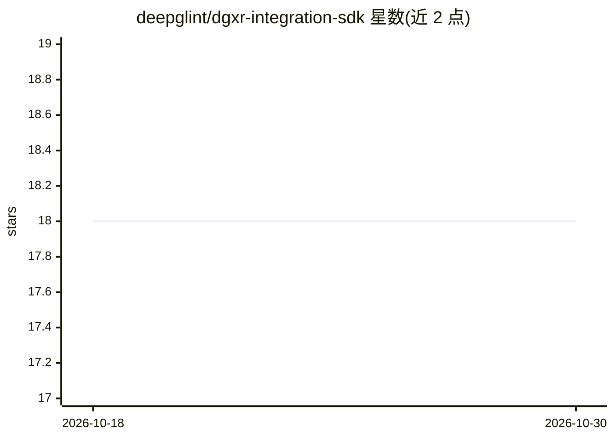

# deepglint/dgxr-integration-sdk

⭐ 18 · C# · MIT · 推送 2025-12-18 · [GitHub](https://github.com/deepglint/dgxr-integration-sdk) · [官网](https://openupm.com/packages/com.deepglint.xr/) · 组织维护 · 中文 README

**给 Unity 开发者的沉浸式空间（灵境空间）XR 应用开发 SDK**

Deepglint 基于 Unity 引擎开发的 XR 软件开发工具包，面向在沉浸式多屏幕空间中开发交互应用的开发者。封装渲染（多屏幕相机自动生成）、身体追踪与骨骼数据、30 余种动作判定（举手/深蹲/跳跃/直拳等）、脚部交互事件、多玩家绑定、空间锚点、空间音频与排行榜二维码等功能。通过 Unity Package Manager 从本地包或 OpenUPM registry 导入，需先在 Unity Hub 创建 URP 模版项目。身体追踪与动作识别为内置能力，但依赖 Deepglint 灵境空间硬件环境，UI 渲染部分注明内部使用暂不对外提供。

## 筛选速览

| 维度 | 判定 | 备注 |
|---|---|---|
| AI 角色 | `ai-native` | 本体是模型或模型工具 |
| 许可风险 | `permissive` | MIT |
| 部署形态 | `None` |  |
| 模型依赖 | — | README 未给出锁定关系 |
| 硬件要求 | — | 无带数字的原话,不猜 |
| 安装摩擦 | `low` | 无编译、无系统依赖或容器化 |
| 成熟度 | — | 结构信号不足 |

## 能力要点

- 自动创建多屏幕渲染相机，开发者无需配置相机与渲染
- 身体追踪与骨骼数据订阅，识别 30 余种动作并支持动作幅度读取
- HumanControlFootPointerInputModule 将脚部交互转为 EventSystem 指针事件
- 多玩家 PlayerManager 角色绑定与设备配对

## 适用场景

- 在沉浸式空间中开发多人互动游戏或课堂应用
- 通过身体动作（深蹲、跳跃、挥手等）控制应用内元素
- 用脚踩踏方式与地面 UI 或 3D 物体交互

## 场景标签

 · 领域:XR/沉浸式空间开发工具

## 证据(README 行号)

> L1: DG Unity Integration SDK is a software development kit developed by Deepglint based on the Unity engine. The SDK enc
> L27: |身体追踪|身体追踪（Body Tracking）用于收集用户的身体位置和动作信息，并将其转换为可再现的姿态数据。|
> L268: `Deepglint.XR.Interaction`模块基于InputSystem的ActionMap机制，提供了包含算法识别、规则判定等多种丰富的动作判定功能，目前`Deepglint.XR.Interaction`支持的动作

## 星数曲线

2026-10-18 18 → 2026-10-30 18（+0）

---
*卡片 v1 · prompt 1.4 · 生成 2026-10-29 · 置信度 mid · 依据 README sha `c39b4db1c39b` · [字段定义](../../DATASET.md)*
